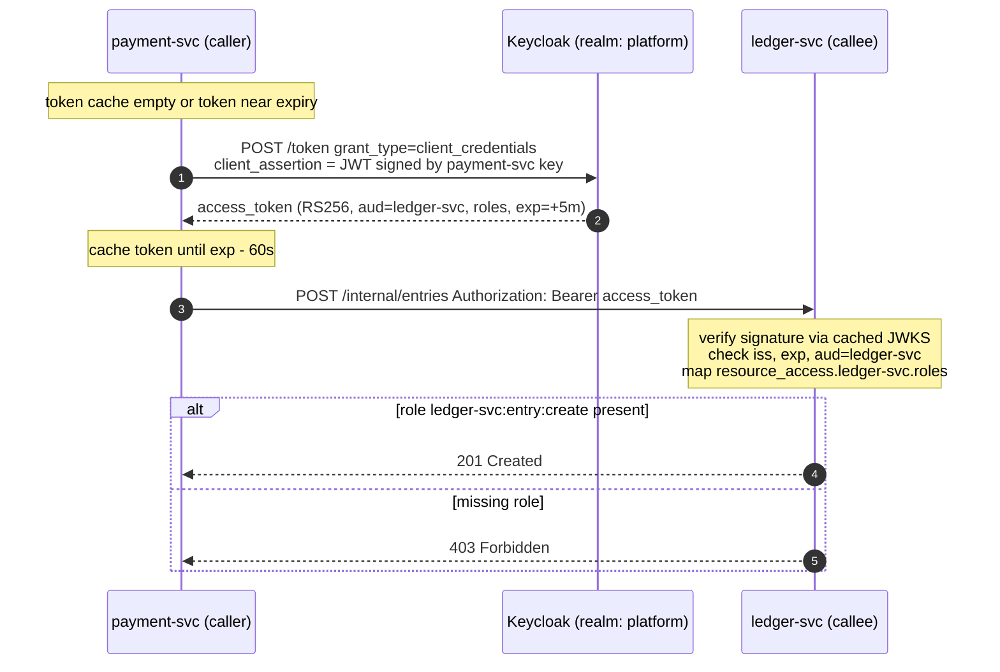

# Service-to-Service Authentication with Keycloak Client Credentials

## 1. Document Control

| Field | Value |
|-------|-------|
| **Document Version** | 1.0 |
| **Date** | October 31, 2026 |
| **Author(s)** | TikTuzki |
| **Reviewed by** | — |
| **Approved by** | — |
| **Status** | Draft |

---

## 2. Introduction

### 2.1 Purpose

Define how one backend service proves its identity to another inside the cluster, and how the
receiving service decides whether that caller may perform the requested operation. The design
uses Keycloak's OAuth 2.0 **client credentials** grant: every calling service is a confidential
client with a service account, receives short-lived signed access tokens, and every receiving
service verifies those tokens itself.

### 2.2 Scope

**In scope**

- Synchronous HTTP calls between backend services (REST over WebClient / any HTTP client).
- Keycloak realm configuration for service identities, roles and audiences.
- Token acquisition and caching in the caller; token verification and authorization in the callee.
- How end-user context travels when a service acts on a user's behalf.
- Migration away from gateway-header trust, and the verification plan.

**Out of scope**

- End-user login flows at the edge (authorization code + PKCE at the API gateway).
- Transport encryption and workload identity at the network layer (mTLS / service mesh) —
  complementary, see [Transport Encryption & Workload Identity with a Service Mesh](/docs/system-design/service-auth/mtls-service-mesh-sdd).
- Authentication to data stores (Postgres, Redis, Kafka) — covered separately.

### 2.3 Definitions & Acronyms

| Term | Meaning |
|------|---------|
| **Caller** | The service initiating an internal HTTP request. |
| **Callee** | The service receiving it. |
| **Client credentials grant** | OAuth 2.0 grant where a client authenticates as itself (no user) and receives an access token. |
| **Service account** | The Keycloak user automatically attached to a client with *Service accounts* enabled; roles assigned to it appear in that client's tokens. |
| **`aud`** | Audience claim — which service(s) a token is meant for. |
| **`azp`** | Authorized party — the client the token was issued to (the caller). |
| **JWKS** | JSON Web Key Set — the realm's public signing keys, used to verify token signatures. |
| **`private_key_jwt`** | Client authentication by a JWT signed with the client's private key, instead of a shared secret. |

---

## 3. System Overview

### 3.1 Context and the problem being fixed

External traffic enters through an API gateway that validates the user's JWT. A common — and
dangerous — pattern then follows inside the cluster:

- The gateway forwards the validated identity as a header (for example a Base64-encoded JSON
  "userinfo" header), and services **trust that header as-is**.
- Or services read the user's Bearer token and **decode its payload without verifying the
  signature**, because "the gateway already checked it".

Both work perfectly in testing, because every test request goes through the gateway. In
production the cluster network is flat: **any pod that can reach a service directly can forge
the header, or send a token whose payload it wrote itself** (`alg: none`, or any signature at
all — it is never checked). An issuer allowlist does not help, because the issuer is just
another claim the forger writes. The service then grants whatever roles the forged claims list.

The same gap exists for service-to-service calls: there is no verifiable way for a service to
know which other service is calling, so either everything is trusted or authorization is
re-derived from forgeable data.

### 3.2 Objectives & Success Criteria

| # | Objective | Success criterion |
|---|-----------|-------------------|
| O1 | Every request to a service carries a credential the service can verify on its own | Callees reject unsigned, wrongly signed, expired, wrong-issuer and wrong-audience tokens with 401 |
| O2 | A service is authorized per operation, not per network location | Each internal endpoint names the role it requires; a caller holding no such role gets 403 |
| O3 | A token minted for one service is useless at another | Tokens carry `aud` of exactly the intended callee(s); callees enforce it |
| O4 | No long-lived shared secrets on the wire | Callers authenticate to Keycloak with `private_key_jwt`; access tokens live ~5 minutes |
| O5 | Keycloak is not on the hot path | Tokens cached by callers, JWKS cached by callees; a Keycloak outage does not fail requests for the lifetime of cached tokens |
| O6 | Forged identity headers have no effect | The callee ignores client-supplied identity headers, and the gateway strips them |

---

## 4. Architectural Design

### 4.1 Architecture Overview



Keycloak issues tokens; it never sits between caller and callee. The callee validates locally
with public keys it fetched once and caches.

### 4.2 Design Principles

1. **Verify, never decode.** A claim is only as trustworthy as the signature over it. Code that
   reads JWT claims without verifying the signature is treated as a defect.
2. **The callee decides.** Authorization happens in the service that owns the data, against
   roles it defines — not at the gateway, not by network position.
3. **One identity per service.** Each service is its own Keycloak client; no shared "internal"
   client, no shared secrets.
4. **Least privilege by role, scoped by audience.** A caller holds only the callee roles it needs,
   and its tokens name the callee in `aud`.
5. **Short-lived, cached, refreshed early.** Tokens live minutes; callers reuse them until shortly
   before expiry.

### 4.3 Components

| Component | Responsibility |
|-----------|----------------|
| Keycloak realm `platform` | Issues signed tokens; holds clients, service accounts, roles, audience mappers; publishes JWKS |
| Caller's token manager | Obtains tokens with client credentials, caches per registration, renews before expiry, attaches the Bearer header |
| Callee's resource server | Verifies signature, `iss`, `exp`, `aud`; converts roles to authorities; enforces per-endpoint rules |
| API gateway | Validates end-user tokens at the edge; strips any client-supplied identity headers; is **not** relied on for internal trust |
| Network policy | Defence in depth: limits which pods can reach which service ports |

### 4.4 Technology Stack

Keycloak 25+ (hostname v2 options), Spring Boot 3.2+ with Spring Security 6 (WebFlux,
`spring-boot-starter-oauth2-client` and `spring-boot-starter-oauth2-resource-server`),
Kubernetes with Sealed Secrets for key delivery. The design is not Spring-specific; any stack
with a JWT library that verifies signatures against a JWKS can implement the callee side.

---

## 5. Detailed Design

### 5.1 Keycloak: identities, roles and audiences

**One confidential client per calling service.**

| Setting | Value | Why |
|---------|-------|-----|
| Client authentication | On (confidential) | The client must prove its identity |
| Service accounts | **On** | Enables the client credentials grant |
| Standard flow / Direct access grants / Implicit | Off | A service never logs a user in |
| Client authenticator | **Signed JWT** (`private_key_jwt`) | No shared secret crosses the network or sits in Keycloak |
| Full scope allowed | Off, with explicit scope role mappings | Tokens carry only roles relevant to the requested scopes |
| Access token lifespan | 5 minutes (realm default is fine) | Limits the value of a leaked token |
| Refresh tokens for client credentials | Off | The client re-authenticates instead; nothing long-lived is issued |

**Roles live on the callee's client.** The service that owns an operation defines it as a client
role, named `callee:resource:action`:

```text
ledger-svc
  ├─ ledger-svc:entry:create
  ├─ ledger-svc:entry:read
  └─ ledger-svc:account:freeze
```

**Grant roles to the caller's service account**, and only the ones it needs. Those roles appear in
the caller's tokens under `resource_access.ledger-svc.roles`.

**Audience.** Keycloak's built-in *audience resolve* mapper (in the default `roles` client scope)
adds a client to `aud` whenever one of that client's roles is in the token, so granting
`ledger-svc` roles already yields `aud: ledger-svc`. Add an explicit *Audience* mapper anyway, so
the audience does not silently depend on the default scopes staying attached.

Reproducible setup with `kcadm.sh` (IDs resolved with `kcadm.sh get clients -q clientId=…`):

```bash
# Callee and its operation roles
kcadm.sh create clients -r platform -s clientId=ledger-svc -s publicClient=false \
  -s serviceAccountsEnabled=false -s standardFlowEnabled=false -s directAccessGrantsEnabled=false
kcadm.sh create clients/$LEDGER_ID/roles -r platform -s name=ledger-svc:entry:create

# Caller: confidential, service account, signed-JWT client authentication
kcadm.sh create clients -r platform -s clientId=payment-svc -s publicClient=false \
  -s serviceAccountsEnabled=true -s standardFlowEnabled=false -s directAccessGrantsEnabled=false \
  -s clientAuthenticatorType=client-jwt -s fullScopeAllowed=false \
  -s 'attributes."use.jwks.url"=false'
# upload payment-svc's public key (Credentials tab → Keys) or point at its JWKS URL

# Least privilege: grant exactly the roles payment-svc needs
kcadm.sh add-roles -r platform --uusername service-account-payment-svc \
  --cclientid ledger-svc --rolename ledger-svc:entry:create
# with full scope off, also add the same role to payment-svc's scope mappings
ROLE_JSON=$(kcadm.sh get clients/$LEDGER_ID/roles/ledger-svc:entry:create -r platform)
kcadm.sh create clients/$PAYMENT_ID/scope-mappings/clients/$LEDGER_ID -r platform \
  -b "[$ROLE_JSON]"   # UI: Client → Client scopes → Dedicated scope → Scope

# Explicit audience
kcadm.sh create clients/$PAYMENT_ID/protocol-mappers/models -r platform \
  -s name=aud-ledger-svc -s protocol=openid-connect -s protocolMapper=oidc-audience-mapper \
  -s 'config."included.client.audience"=ledger-svc' -s 'config."access.token.claim"=true'
```

Keep these commands in version control (or use a declarative tool such as `keycloak-config-cli`)
so the realm can be rebuilt and reviewed; hand-clicked realms drift.

### 5.2 The resulting token

```json
{
  "iss": "https://sso.example.com/realms/platform",
  "aud": "ledger-svc",
  "azp": "payment-svc",
  "sub": "5c1f…",
  "exp": 1793427000,
  "iat": 1793426700,
  "typ": "Bearer",
  "resource_access": {
    "ledger-svc": { "roles": ["ledger-svc:entry:create"] }
  },
  "client_id": "payment-svc"
}
```

`azp` / `client_id` identify the caller; `sub` is the service-account user. Log `azp` on every
authorized internal call — it is the audit answer to "which service did this?".

### 5.3 Caller: obtain, cache, attach

The token manager must work **without an incoming request** — Kafka consumers and schedulers
call other services too — so use the service-scoped manager, not the request-scoped default.

```yaml
spring:
  security:
    oauth2:
      client:
        registration:
          ledger:
            provider: platform
            client-id: payment-svc
            authorization-grant-type: client_credentials
            client-authentication-method: private_key_jwt
        provider:
          platform:
            # back-channel: internal URL is fine for the token endpoint
            token-uri: http://keycloak.auth.svc.cluster.local/realms/platform/protocol/openid-connect/token
```

```java
@Configuration
class InternalClients {

  @Bean
  ReactiveOAuth2AuthorizedClientManager authorizedClientManager(
      ReactiveClientRegistrationRepository registrations,
      ReactiveOAuth2AuthorizedClientService authorizedClients,
      Function<ClientRegistration, JWK> clientSigningKey) {   // loads the private key from a mounted file

    var tokenClient = new WebClientReactiveClientCredentialsTokenResponseClient();
    tokenClient.addParametersConverter(
        new NimbusJwtClientAuthenticationParametersConverter<>(clientSigningKey));

    var provider = ReactiveOAuth2AuthorizedClientProviderBuilder.builder()
        .clientCredentials(cc -> cc
            .accessTokenResponseClient(tokenClient)
            .clockSkew(Duration.ofSeconds(60)))      // renew 60 s before expiry
        .build();

    var manager = new AuthorizedClientServiceReactiveOAuth2AuthorizedClientManager(
        registrations, authorizedClients);
    manager.setAuthorizedClientProvider(provider);
    return manager;
  }

  @Bean
  WebClient ledgerClient(ReactiveOAuth2AuthorizedClientManager manager, WebClient.Builder builder) {
    var oauth = new ServerOAuth2AuthorizedClientExchangeFilterFunction(manager);
    oauth.setDefaultClientRegistrationId("ledger");
    return builder.baseUrl("http://ledger-svc.payments.svc.cluster.local:8080")
        .filter(oauth)
        .build();
  }
}
```

Rules for callers:

- **Never request a token per call.** The manager caches per registration; one token serves every
  call until it is renewed.
- **One registration per callee audience**, so a token for `ledger-svc` is never sent to another
  service.
- **The signing key is a file**, mounted from a sealed secret with a restrictive mode — not an
  environment variable (it would be visible to every child process and in crash dumps).
- **On 401 from the callee**, drop the cached token and retry once; a second 401 is a real error.

### 5.4 Callee: verify, then authorize

```yaml
spring:
  security:
    oauth2:
      resourceserver:
        jwt:
          issuer-uri: https://sso.example.com/realms/platform     # validated against iss
          jwk-set-uri: http://keycloak.auth.svc.cluster.local/realms/platform/protocol/openid-connect/certs
          audiences: ledger-svc                                    # validated against aud (Boot 3.2+)
          jws-algorithms: RS256                                    # anything else, including none, is rejected
```

With both `issuer-uri` and `jwk-set-uri` set, keys are fetched from the internal URL while the
issuer is still checked against the public one. Spring caches the JWKS and refetches when it sees
an unknown key id, so Keycloak key rotation needs no deploy.

Keycloak puts client roles under `resource_access`, not in `scope`, so map them explicitly:

```java
@Configuration
@EnableWebFluxSecurity
@EnableReactiveMethodSecurity
class SecurityConfig {

  private static final String SELF = "ledger-svc";

  @Bean
  SecurityWebFilterChain chain(ServerHttpSecurity http) {
    return http
        .csrf(ServerHttpSecurity.CsrfSpec::disable)
        .authorizeExchange(auth -> auth
            .pathMatchers("/actuator/health/**").permitAll()
            .pathMatchers(HttpMethod.POST, "/internal/entries").hasAuthority("ledger-svc:entry:create")
            .pathMatchers("/internal/**").authenticated()
            .anyExchange().authenticated())
        .oauth2ResourceServer(rs -> rs.jwt(jwt -> jwt.jwtAuthenticationConverter(this::toAuthentication)))
        .build();
  }

  @SuppressWarnings("unchecked")
  private Mono<AbstractAuthenticationToken> toAuthentication(Jwt jwt) {
    Map<String, Object> access = jwt.getClaimAsMap("resource_access");
    Map<String, Object> self = access == null ? Map.of()
        : (Map<String, Object>) access.getOrDefault(SELF, Map.of());
    Collection<String> roles = (Collection<String>) self.getOrDefault("roles", List.of());
    var authorities = roles.stream().map(SimpleGrantedAuthority::new).toList();
    return Mono.just(new JwtAuthenticationToken(jwt, authorities, jwt.getClaimAsString("azp")));
  }
}
```

Only the callee's **own** client roles become authorities. Roles a token carries for other
clients are ignored, so a token that is valid for `ledger-svc` cannot smuggle in authority meant
for a third service.

**Remove every unverified path.** If an existing filter reads an identity header or decodes the
JWT payload directly, delete it, or keep it only behind an explicit, default-off flag for the
migration window (section 10). A single remaining "fallback" makes the verified path irrelevant —
an attacker simply uses the fallback.

### 5.5 Issuer and hostname

The `iss` claim is the URL the token was issued under. If callers fetch tokens via the internal
service URL while callees expect the public URL, **every call fails with 401** — and it only shows
up after deployment, because local setups use one URL for everything.

Pin Keycloak's frontend hostname so `iss` is constant no matter which URL a client used:

```bash
kc.sh start --hostname=https://sso.example.com --hostname-backchannel-dynamic=true
```

Callers and callees may then use internal URLs for the token and JWKS endpoints, while `iss` stays
`https://sso.example.com/realms/platform` everywhere.

### 5.6 End-user context

A client credentials token says **which service** is calling, never which user it acts for.
Decide per operation:

| Situation | Approach | Notes |
|-----------|----------|-------|
| The callee executes a command the caller already authorized for the user (most internal commands) | **Service token**; user id travels as request data | Simplest. The callee trusts the *caller's* authorization, so the role it grants must be narrow. |
| The callee must enforce per-user rules itself (ownership, limits, KYC level) | **Token exchange** (RFC 8693): the caller exchanges the user's token for one with the user as subject and `aud` = callee | Keycloak supports standard token exchange in recent versions (26.2+); enable it per client. |
| Forwarding the user's original token downstream | **Never** | Its audience is the edge, it is replayable at every service that receives it, and it turns each hop into a confused deputy. |

---

## 6. Integration & Interfaces

### 6.1 API gateway

- Continues to validate end-user tokens at the edge.
- **Strips client-supplied identity headers on every route** (including routes without an
  authentication plugin, where a client's header would otherwise pass straight through).
- Forwards the verified `Authorization` header (or an exchanged token) to services, which verify it
  again. Double verification costs microseconds; trusting the edge costs the whole cluster.

### 6.2 Internal endpoints

Internal-only operations live under `/internal/**`, are not exposed through the gateway, and each
names its required role. Public endpoints keep their user-facing authorization; both paths verify
tokens the same way.

### 6.3 Asynchronous messaging

Kafka messages do not carry access tokens (they outlive them). Producer identity on topics is
enforced by broker authentication and ACLs, covered in the data-store design.

---

## 7. Security Design

| Threat | Mitigation |
|--------|------------|
| Pod forges an identity header | Callees ignore identity headers; gateway strips them; network policy limits who can reach the port |
| Token with forged payload / `alg: none` | Signature verified against realm JWKS; only RS256 accepted |
| Token for service A replayed at service B | `aud` enforced by every callee |
| Token from another realm or IdP | `iss` checked against the configured issuer |
| Leaked access token | 5-minute lifetime; scoped to one audience and a few roles |
| Leaked client credential | `private_key_jwt` keys are per service, rotatable by uploading a new public key; no secret stored in Keycloak |
| Over-privileged caller | Roles granted per operation; full scope off; reviewed in version-controlled realm config |
| Compromised caller | Blast radius = the roles its service account holds — the reason roles are per operation, not per service |
| Keycloak signing-key compromise | Rotate realm keys; callees refetch JWKS on unknown key id |

Network policy (default-deny with explicit allows) remains in place as defence in depth: tokens
decide *what* a caller may do; network policy decides *who can try*.

---

## 8. Performance & Scalability

| Item | Cost |
|------|------|
| Token requests | One per (caller instance × callee audience) per ~4 minutes. 30 instances × 5 audiences ≈ 0.6 requests/s — negligible for Keycloak |
| Signature verification | One RS256 verify per request, sub-millisecond |
| JWKS fetch | Once at startup and on key rotation |
| Added latency per call | One header; no network round trip to Keycloak on the request path |

---

## 9. Reliability & Availability

- **Keycloak outage**: requests keep working with cached tokens and cached JWKS. New tokens cannot
  be issued, so callers start failing roughly one token lifetime after the outage begins. Keycloak
  must therefore be highly available, but it is not a per-request dependency.
- **Clock skew**: tolerate up to 60 seconds; keep nodes on NTP.
- **Key rotation**: Keycloak keeps the previous key active while new tokens use the new one;
  callees refetch JWKS automatically.
- **Startup ordering**: a callee whose JWKS endpoint is unreachable at startup should not crash —
  fetch lazily on first request and report readiness only when the issuer is reachable.

---

## 10. Rollout Plan

| Phase | Change | Exit criterion |
|-------|--------|----------------|
| 0. Contain | Gateway strips identity headers on all routes; network policy allows each service port only from the gateway and known callers | Forged-header test (section 11) fails from an arbitrary pod |
| 1. Identities | Create clients, roles, scope mappings and audience mappers in version-controlled realm config | Every caller can obtain a token with the expected `aud` and roles |
| 2. Callers | Switch internal HTTP clients to client-credentials WebClients | Internal requests carry Bearer tokens (verified in access logs) |
| 3. Callees, report-only | Verify tokens and log what *would* be rejected, without rejecting | Zero unexpected rejections over a full business cycle |
| 4. Enforce | Reject unverified requests; remove header-trust and payload-decode paths | Negative test suite passes in every environment |
| 5. Least privilege | Replace any broad roles with per-operation roles | Each internal endpoint names one specific role |

Phase 3 matters: switching straight to enforcement finds the forgotten caller (a batch job, a
consumer, an admin tool) as an outage.

---

## 11. Verification

Run these from a pod **inside** the cluster, against every callee. Each must be rejected.

```bash
# 1. Forged identity header, no token                              → 401
curl -s -o /dev/null -w '%{http_code}\n' -X POST http://ledger-svc:8080/internal/entries \
  -H "X-Userinfo: $(printf '{"iss":"https://sso.example.com/realms/platform","resource_access":{"ledger-svc":{"roles":["ledger-svc:entry:create"]}}}' | base64)"

# 2. Unsigned token (alg none) with the same claims                → 401
HDR=$(printf '{"alg":"none","typ":"JWT"}' | base64 | tr -d '=' | tr '/+' '_-')
BODY=$(printf '{"iss":"https://sso.example.com/realms/platform","aud":"ledger-svc","exp":9999999999,"resource_access":{"ledger-svc":{"roles":["ledger-svc:entry:create"]}}}' | base64 | tr -d '=' | tr '/+' '_-')
curl -s -o /dev/null -w '%{http_code}\n' -X POST http://ledger-svc:8080/internal/entries \
  -H "Authorization: Bearer $HDR.$BODY."

# 3. Valid token for a different audience                          → 401
# 4. Valid token, right audience, missing role                     → 403
# 5. Expired token                                                 → 401
# 6. Valid token, right audience and role                          → 2xx
```

Keep 1–5 as automated tests in each service; they are the regression guard against someone
re-adding a "convenient" fallback.

---

## 12. Risks & Mitigations

| Risk | Impact | Mitigation |
|------|--------|------------|
| A caller is missed during migration | Outage when enforcement starts | Report-only phase; inventory callers from access logs, not from memory |
| Issuer URL mismatch between environments | Every call 401 after deploy | Pinned Keycloak hostname; issuer in config per environment; smoke test after each deploy |
| Roles granted too broadly "to unblock" | Compromise of one service reaches unrelated operations | Per-operation roles; realm config reviewed like code |
| A fallback to header/payload trust survives | The whole design is bypassed | Negative tests in CI; grep for payload decoding in review |
| Keycloak down for longer than a token lifetime | Internal calls fail | HA Keycloak; alert on token-endpoint errors; consider a longer lifespan only for non-sensitive audiences |

---

## 13. Review Checklist

- [ ] Every caller is its own confidential client with a service account; flows other than client credentials are off
- [ ] Callers authenticate with `private_key_jwt`; private keys are mounted files from sealed secrets
- [ ] Roles are defined on the callee's client as `callee:resource:action` and granted per caller
- [ ] Tokens carry `aud` of the intended callee; callees enforce `aud`, `iss`, `exp` and RS256 signatures
- [ ] Only the callee's own client roles become authorities
- [ ] No code path reads identity from headers or from an unverified JWT payload
- [ ] The gateway strips client-supplied identity headers on every route
- [ ] Callers cache tokens and renew before expiry; nothing requests a token per call
- [ ] Token managers work without an incoming request (consumers, schedulers)
- [ ] Keycloak hostname is pinned so `iss` is identical for internal and external clients
- [ ] Each internal call logs the caller's `azp`
- [ ] Negative tests 1–5 run in CI for every service
