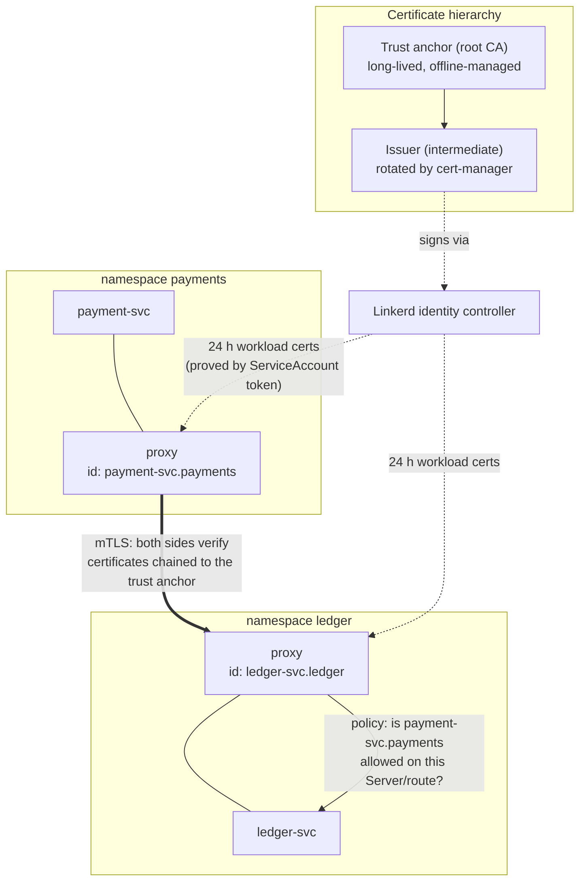

# Transport Encryption & Workload Identity with a Service Mesh (mTLS)

## 1. Document Control

| Field | Value |
|-------|-------|
| **Document Version** | 1.0 |
| **Date** | October 31, 2026 |
| **Author(s)** | TikTuzki |
| **Reviewed by** | — |
| **Approved by** | — |
| **Status** | Draft |

---

## 2. Introduction

### 2.1 Purpose

Define how traffic between workloads inside the Kubernetes cluster is **encrypted**, and how each
workload gets a **cryptographic identity** that the receiving side can verify and authorize —
without changing application code. The design uses a service mesh (Linkerd) for automatic mutual
TLS, identities derived from Kubernetes ServiceAccounts, and deny-by-default authorization
policies keyed on those identities.

### 2.2 Scope

**In scope**

- Encryption and mutual authentication of pod-to-pod TCP and HTTP traffic.
- Workload identity: how it is issued, rotated and verified.
- Identity-based authorization at the network layer (which workload may connect to which port or route).
- Certificate hierarchy and lifecycle (trust anchor, issuer, workload certificates).
- Mesh operational concerns: startup ordering, Jobs, protocol detection, ingress, data stores.
- Rollout and verification plan.

**Out of scope**

- Per-operation authorization and end-user context —
  see [Service-to-Service Authentication with Keycloak](/docs/system-design/service-auth/keycloak-client-credentials-sdd).
  The mesh answers *which workload is connecting*; tokens answer *what that caller may do*.
- Traffic entering the cluster from the internet (edge TLS at the ingress/gateway).
- Data-store authentication (database users, broker ACLs) — the mesh encrypts those connections
  but does not replace their own authentication.

### 2.3 Definitions & Acronyms

| Term | Meaning |
|------|---------|
| **mTLS** | Mutual TLS — both client and server present certificates and verify each other. |
| **Workload identity** | A cryptographic name for a running workload, bound to its ServiceAccount (e.g. `payment-svc.payments.serviceaccount.identity.linkerd.cluster.local`). |
| **Trust anchor** | The root CA certificate every proxy trusts. Long-lived; its expiry breaks the whole mesh at once. |
| **Issuer** | Intermediate CA signed by the trust anchor; signs workload certificates. Rotated regularly. |
| **Proxy / sidecar** | The mesh's data-plane process running next to each application container, terminating and originating mTLS. |
| **Opaque port** | A port the proxy treats as raw TCP (no protocol detection) — required for server-speaks-first protocols. |
| **Server / AuthorizationPolicy** | Linkerd policy resources: a `Server` selects pods and a port; an `AuthorizationPolicy` says which identities may reach it. |

---

## 3. System Overview

### 3.1 Context and the problem being fixed

Without a mesh, pod-to-pod traffic in Kubernetes is plaintext and anonymous:

- **Anyone on the path can read it.** Within one node that path is local, but across nodes it
  crosses the physical network, and any compromised node or host-network pod can observe it.
- **The receiver cannot tell who connected.** A connection carries a source IP, and pod IPs are
  reused constantly. A NetworkPolicy allowing "pods with label `app=payment`" trusts a label any
  deployment can set, not a cryptographic proof.
- **Applications that do their own TLS rarely verify identity.** One-way TLS to an internal
  service proves the *server* to the client, and usually only that it holds *some* certificate from
  *some* CA — the caller stays anonymous.

The common partial fixes each leave a gap:

| Approach | Encrypts | Proves caller identity | Gap |
|----------|----------|------------------------|-----|
| NetworkPolicy only | No | No (labels/IPs) | Plaintext; labels are not identity |
| Node-to-node WireGuard (CNI) | Across nodes | No | Same-node traffic plaintext; no per-workload identity or policy |
| App-level one-way TLS | Yes | No | Caller anonymous; every app manages certificates |
| App-level mTLS (DIY) | Yes | Yes | Every app loads, rotates and verifies certificates — and the reload is where it fails |
| **Service mesh mTLS** | Yes | Yes | Operational dependency on the mesh (section 9) |

### 3.2 Objectives & Success Criteria

| # | Objective | Success criterion |
|---|-----------|-------------------|
| O1 | All pod-to-pod traffic between meshed workloads is encrypted | `linkerd viz edges` shows every edge as secured; plaintext connections to meshed ports are refused |
| O2 | Every workload has its own identity | One ServiceAccount per workload; no workload runs as `default` |
| O3 | Ports are reachable only by identities that need them | Default inbound policy `deny` (after audit); every Server has an explicit AuthorizationPolicy |
| O4 | Certificates never expire unattended | Issuer rotated automatically; trust-anchor expiry alerted ≥ 60 days ahead; workload certs rotate every 24 h |
| O5 | No application code changes for encryption or identity | Services keep speaking plain HTTP/TCP to `localhost`-side proxies |
| O6 | Mesh overhead stays within budget | Added p99 latency per hop under ~1–2 ms; proxy memory within its limit |

---

## 4. Architectural Design

### 4.1 Architecture Overview



Request path: the application sends plain HTTP to its own proxy; the proxy opens an mTLS
connection to the destination proxy, presenting its workload certificate; the destination proxy
verifies the chain and the peer identity, applies authorization policy, then forwards plaintext
over the pod's loopback to the application.

### 4.2 Design Principles

1. **Identity comes from the ServiceAccount.** A workload proves who it is with its projected
   ServiceAccount token; the mesh turns that into a short-lived certificate. Therefore every workload
   gets its own ServiceAccount.
2. **Encrypt by default, authorize explicitly.** Meshing encrypts everything; authorization starts
   in audit, then moves to deny-by-default with explicit allows.
3. **Short-lived leaves, rotated roots.** Workload certificates live 24 hours; the issuer rotates
   automatically; the trust anchor has a written rotation procedure and an alert.
4. **The mesh is not authorization of business operations.** It decides which workload may connect;
   the application still decides what the caller may do.
5. **Prefer boring.** Linkerd over a feature-rich mesh, because its failure modes are fewer and its
   defaults (automatic mTLS, no configuration per service) match the objective.

### 4.3 Components

| Component | Responsibility |
|-----------|----------------|
| Linkerd control plane | Identity controller (issues workload certs), destination controller (service discovery, policy distribution), proxy injector |
| Linkerd proxy (per pod) | Terminates/originates mTLS, enforces inbound policy, emits golden metrics |
| cert-manager | Issues and rotates the Linkerd issuer certificate from the trust anchor |
| trust-manager | Distributes the trust-anchor bundle (supports two anchors during rotation) |
| Policy resources | `Server`, `AuthorizationPolicy`, `MeshTLSAuthentication`, `HTTPRoute` per protected workload |
| NetworkPolicy (CNI) | Defence in depth at L3/L4, including for non-meshed pods |

### 4.4 Technology Choice

| Option | Choose when | Not when |
|--------|-------------|----------|
| **Linkerd** (chosen) | The goal is mTLS + identity + per-workload policy with minimal operations; mostly HTTP/gRPC services | You need rich L7 traffic management, multi-cluster federation beyond basics, or VM workloads |
| Istio (sidecar or ambient) | You need advanced L7 policy, traffic shaping, extensive extensibility; ambient avoids sidecars | The team cannot absorb its operational surface; PERMISSIVE mode tends to stay forever |
| Cilium mesh / WireGuard | Encryption across nodes is the main goal and the CNI is already Cilium | You need per-workload identity verified on every connection |
| DIY mTLS with cert-manager | One or two services, no mesh appetite | More than a few services — certificate reload and verification get reimplemented per app |

---

## 5. Detailed Design

### 5.1 Certificate hierarchy

| Certificate | Lifetime | Managed by | Rotation |
|-------------|----------|------------|----------|
| Trust anchor (root, ECDSA P-256) | 5–10 years | Platform team; private key kept out of the cluster | Planned: add new anchor to the bundle, roll issuer, remove old anchor |
| Issuer (intermediate) | 48 h – 1 year | cert-manager `Certificate` signed by the anchor | Automatic; Linkerd picks up the new secret |
| Workload certificate | 24 h | Linkerd identity controller | Automatic, before expiry |

```yaml
# The trust anchor's key signs only the issuer; keep the key outside the cluster where possible.
apiVersion: cert-manager.io/v1
kind: Issuer
metadata: { name: linkerd-trust-anchor, namespace: linkerd }
spec:
  ca: { secretName: linkerd-trust-anchor }      # root cert + key (or use an external CA issuer)
---
apiVersion: cert-manager.io/v1
kind: Certificate
metadata: { name: linkerd-identity-issuer, namespace: linkerd }
spec:
  secretName: linkerd-identity-issuer
  duration: 48h
  renewBefore: 25h
  issuerRef: { name: linkerd-trust-anchor, kind: Issuer }
  commonName: identity.linkerd.cluster.local
  dnsNames: [identity.linkerd.cluster.local]
  isCA: true
  privateKey: { algorithm: ECDSA }
  usages: [cert sign, crl sign, server auth, client auth]
```

Install Linkerd with `identity.issuer.scheme=kubernetes.io/tls` so it reads the issuer from that
secret instead of a static file, and pass the trust-anchor **certificate** (not key) as the
identity trust roots.

**The classic mesh outage is an expired trust anchor or issuer.** Certificates generated by the CLI
quick-start are valid for one year; a year later every proxy rejects every peer at the same
moment. Alert on both expiries (cert-manager exports
`certmanager_certificate_expiration_timestamp_seconds`; the anchor needs a separate check), and
rehearse anchor rotation before it is needed.

### 5.2 Workload identity

- **One ServiceAccount per workload**, named after it, `automountServiceAccountToken` as the
  workload needs. A shared `default` ServiceAccount makes every workload in the namespace the same
  identity, and identity-based policy collapses.
- Identity format: `<serviceaccount>.<namespace>.serviceaccount.identity.linkerd.cluster.local`.
- The identity controller verifies the pod's projected ServiceAccount token before signing, so a pod
  cannot claim another workload's identity without that workload's token.

### 5.3 Meshing workloads

Enable injection per namespace, and opt out deliberately:

```yaml
apiVersion: v1
kind: Namespace
metadata:
  name: payments
  annotations:
    linkerd.io/inject: enabled
    config.linkerd.io/default-inbound-policy: audit   # → deny after the audit phase
```

| Concern | Problem | Handling |
|---------|---------|----------|
| **Startup ordering** | The app starts before its proxy is ready and its first outbound calls fail | Native sidecars (Kubernetes 1.29+, `config.alpha.linkerd.io/proxy-enable-native-sidecar: "true"`), or `config.linkerd.io/proxy-await: enabled` |
| **Jobs and CronJobs** | The Job never completes because the proxy keeps running | Native sidecars; otherwise the job shuts the proxy down on exit |
| **Init containers** | They run before the proxy and cannot use the mesh | Keep init containers to local work; with native sidecars the proxy starts first |
| **Server-speaks-first protocols** | Protocol detection waits for client bytes that never come, connections hang | Mark the port opaque. Defaults cover 25, 587, 3306, 4444, 5432, 6379, 9300, 11211 — **Kafka (9092/9093) is not covered**; annotate `config.linkerd.io/opaque-ports` |
| **hostNetwork pods** | Cannot be meshed | Keep them out of meshed namespaces; reach them with explicit NetworkPolicy |
| **Kubelet probes** | Probes are not mTLS | Linkerd authorizes probes to the paths declared in the pod spec automatically — keep probes on dedicated paths |
| **Ingress** | The ingress → service hop is plaintext unless the ingress is meshed | Mesh the ingress controller (`ingress` injection mode for nginx-style controllers) |

### 5.4 Authorization policy

Three stages: **audit** (log what would be denied), then **deny by default**, then **explicit
allows** per port or route.

```yaml
# The port being protected
apiVersion: policy.linkerd.io/v1beta3
kind: Server
metadata: { name: ledger-http, namespace: ledger }
spec:
  podSelector: { matchLabels: { app: ledger-svc } }
  port: http
  proxyProtocol: HTTP/1
---
# Who may connect
apiVersion: policy.linkerd.io/v1alpha1
kind: MeshTLSAuthentication
metadata: { name: ledger-callers, namespace: ledger }
spec:
  identities:
    - payment-svc.payments.serviceaccount.identity.linkerd.cluster.local
    - reconciliation-job.ops.serviceaccount.identity.linkerd.cluster.local
---
apiVersion: policy.linkerd.io/v1alpha1
kind: AuthorizationPolicy
metadata: { name: ledger-http-callers, namespace: ledger }
spec:
  targetRef: { group: policy.linkerd.io, kind: Server, name: ledger-http }
  requiredAuthenticationRefs:
    - { group: policy.linkerd.io, kind: MeshTLSAuthentication, name: ledger-callers }
```

API versions above match recent Linkerd releases and have changed between versions; check
yours with `kubectl api-resources --api-group=policy.linkerd.io`. The `audit` default policy also
requires a recent release.

For finer control, target an `HTTPRoute` (for example only `POST /internal/entries`) instead of the
whole Server. Keep policies next to the workload's manifests so a new caller is a reviewed change to
the callee, never a broad namespace-wide allow.

Policy denials surface as `403` for HTTP and as refused connections for TCP. In audit mode they are
logged and counted but allowed — this is how missing allows are found before enforcement.

### 5.5 Data stores and stateful sets

| Option | When |
|--------|------|
| Mesh the data store (opaque port) | Gains encryption and identity-based allow lists (only `payment-svc` may reach Postgres 5432). Works, but replication and failover traffic between members also runs through proxies — mesh stateless services first |
| Native TLS of the store, port skipped by the mesh | When the store's own TLS with full verification is already in place, or its cluster protocol misbehaves behind a proxy |

Either way, the store keeps its own authentication (database users, broker ACLs): the mesh proves
which workload connected, not which database role it should be.

### 5.6 Egress

Traffic leaving the cluster is not covered by mesh mTLS. Keep outbound TLS to third parties in the
application with full certificate verification, and restrict egress with NetworkPolicy (or an egress
gateway) so a compromised workload cannot reach arbitrary destinations.

---

## 6. Integration & Interfaces

- **With token-based authorization**: unchanged. The application still verifies bearer tokens
  (see the Keycloak SDD). The mesh adds a second, independent check: a stolen token is useless from
  a workload whose identity is not allowed to reach the port.
- **With NetworkPolicy**: kept. NetworkPolicy covers non-meshed pods and is enforced by the CNI even
  if a proxy is misconfigured.
- **With observability**: the mesh emits per-route success rate, latency and request volume for
  every meshed workload without instrumentation. `tcpdump` on pod traffic now shows ciphertext —
  use the mesh's tap tooling to inspect requests.

---

## 7. Security Design

| Threat | Mitigation |
|--------|------------|
| Eavesdropping on pod traffic (across or within nodes) | mTLS between proxies for all meshed traffic |
| Workload impersonation by IP or label | Identity is a certificate obtained with the workload's own ServiceAccount token |
| Lateral movement from a compromised pod | Deny-by-default inbound policy; only listed identities reach each port or route |
| Stolen workload certificate | 24 h lifetime; bound to one identity's allow lists |
| Compromised issuer key | Rotate the issuer; short issuer lifetime limits exposure |
| Compromised trust-anchor key | Anchor rotation procedure; key kept outside the cluster |
| Plaintext fallback | Meshed ports refuse non-mTLS connections once policy is enforced; monitor for non-meshed edges |
| Mesh misconfiguration opens access | Policies reviewed with the workload; audit phase before deny; NetworkPolicy as an independent layer |

---

## 8. Performance & Scalability

| Item | Typical cost |
|------|-------------|
| Latency per hop | Sub-millisecond to ~1–2 ms added at p99 (two proxies per request) |
| Proxy memory | Tens of MB per pod; set requests/limits on the proxy container |
| Proxy CPU | Proportional to request rate; TLS handshakes amortized by connection reuse |
| Load balancing | The proxy balances per request (not per connection), which fixes uneven load from long-lived HTTP/2 and gRPC connections |

Measure on real traffic during rollout; set an SLO for the added p99 and back out a namespace that
exceeds it.

---

## 9. Reliability & Availability

- **Control plane HA**: run the Linkerd control plane with multiple replicas (HA values). Existing
  connections and cached certificates keep working if the control plane is briefly unavailable, but
  new pods cannot get identities.
- **Certificate expiry** is the dominant failure mode — see 5.1. Alert on anchor and issuer expiry,
  and on proxies reporting identity errors.
- **Upgrades**: control plane first, then roll workloads to pick up the new proxy version, namespace
  by namespace.
- **Clock skew**: certificate validation depends on time; keep nodes on NTP.
- **Escape hatch**: removing the injection annotation and restarting a workload takes it out of the
  mesh; document it, and know that it bypasses mesh policy (NetworkPolicy still applies).

---

## 10. Rollout Plan

| Phase | Change | Exit criterion |
|-------|--------|----------------|
| 0. Prepare | One ServiceAccount per workload; certificate hierarchy with cert-manager; expiry alerts | No workload uses `default`; issuer rotates in staging |
| 1. Install | Linkerd control plane (HA) with external issuer | `linkerd check` passes |
| 2. Mesh stateless services | Inject namespace by namespace with policy `audit`; native sidecars; opaque ports for Kafka | All edges secured in `linkerd viz edges`; latency within budget |
| 3. Mesh ingress | Inject the ingress controller | Ingress → service edges secured |
| 4. Write policies | `Server` + `AuthorizationPolicy` per workload from observed edges | Audit log shows no would-be denials for a full business cycle |
| 5. Enforce | Default inbound policy `deny` per namespace | Negative tests (section 11) pass |
| 6. Data stores | Mesh stores with opaque ports, or verify native TLS and skip | Store connections encrypted and allow-listed |

---

## 11. Verification

```bash
# Every edge is mTLS ("√" in SECURED)
linkerd viz edges deployment -n payments

# Identity of the peers on a live connection
linkerd viz tap deploy/ledger-svc -n ledger | grep tls=true

# A pod with a non-allowed identity is refused (expect 403 / connection refused)
kubectl run probe --rm -it -n default --image=curlimages/curl -- \
  curl -s -o /dev/null -w '%{http_code}\n' http://ledger-svc.ledger:8080/internal/entries

# A non-meshed client cannot talk plaintext to a meshed, enforced port (expect refused)
kubectl run plain --rm -it -n unmeshed --image=curlimages/curl -- \
  curl -s -m 5 http://ledger-svc.ledger:8080/actuator/health/readiness

# Certificate expiries are visible
kubectl -n linkerd get certificate linkerd-identity-issuer -o jsonpath='{.status.notAfter}'
```

Keep the negative checks in a scheduled job: policy regressions are silent until someone is
breached.

---

## 12. Risks & Mitigations

| Risk | Impact | Mitigation |
|------|--------|------------|
| Trust anchor or issuer expires | Every meshed call fails at once | cert-manager rotation; expiry alerts; rehearsed anchor rotation |
| A caller is missed when moving to deny | Outage of that caller | Audit phase; policies derived from observed edges, not memory |
| Server-speaks-first port not marked opaque | Connections hang (looks like the service is down) | Inventory ports; annotate Kafka and any custom protocol |
| Jobs never finish / apps start before proxy | Stuck jobs, failed boots | Native sidecars; proxy-await |
| Shared ServiceAccounts | Identity policy meaningless | Phase 0 gate: one ServiceAccount per workload |
| Mesh treated as authorization | Over-trusting any allowed workload | Keep token-based per-operation authorization in the applications |
| Proxy overhead on hot paths | Latency SLO missed | Measure per namespace; tune proxy resources; exclude only with a documented reason |

---

## 13. Review Checklist

- [ ] Every workload has its own ServiceAccount; none uses `default`
- [ ] Trust anchor key kept outside the cluster; issuer issued and rotated by cert-manager
- [ ] Alerts fire well before trust-anchor and issuer expiry; anchor rotation rehearsed
- [ ] Namespaces meshed with native sidecars (or proxy-await); Jobs complete
- [ ] Kafka and other server-speaks-first ports are marked opaque
- [ ] Ingress controller is meshed
- [ ] Default inbound policy is `deny` after an audit phase; every Server has an explicit AuthorizationPolicy
- [ ] Policies live with the callee's manifests and name specific identities
- [ ] All edges show as secured; non-allowed identities and plaintext clients are refused
- [ ] Data stores either meshed with opaque ports or on verified native TLS — and keep their own authentication
- [ ] Applications still verify tokens for per-operation authorization
- [ ] NetworkPolicy remains in place as an independent layer
