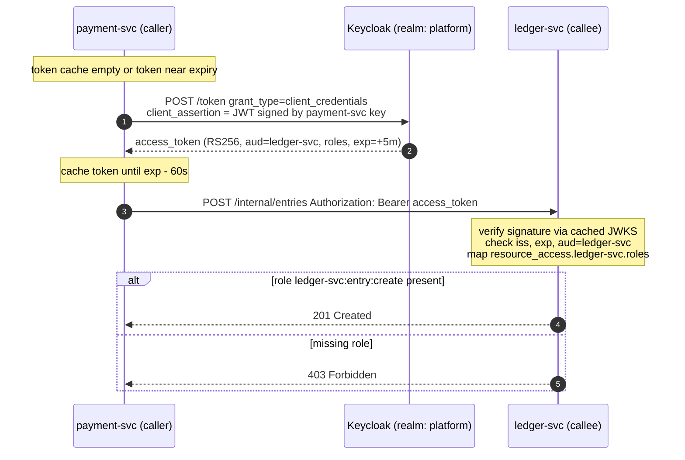

# Xác thực giữa các service với Keycloak Client Credentials

## 1. Kiểm soát tài liệu

| Trường | Giá trị |
|-------|-------|
| **Phiên bản tài liệu** | 1.0 |
| **Ngày** | 31/10/2026 |
| **Tác giả** | TikTuzki |
| **Người review** | — |
| **Người phê duyệt** | — |
| **Trạng thái** | Bản nháp |

---

## 2. Giới thiệu

### 2.1 Mục đích

Định nghĩa cách một backend service chứng minh danh tính của mình với service khác bên trong
cluster, và cách service nhận quyết định caller đó có được thực hiện thao tác được yêu cầu hay
không. Thiết kế dùng grant **client credentials** của OAuth 2.0 trên Keycloak: mỗi service gọi đi
là một confidential client có service account, nhận access token đã ký với thời hạn ngắn, và mỗi
service nhận tự verify token đó.

### 2.2 Phạm vi

**Trong phạm vi**

- Lời gọi HTTP đồng bộ giữa các backend service (REST qua WebClient hoặc bất kỳ HTTP client nào).
- Cấu hình realm Keycloak cho danh tính service, role và audience.
- Lấy và cache token ở caller; verify token và phân quyền ở callee.
- Cách ngữ cảnh người dùng cuối được truyền đi khi một service hành động thay mặt người dùng.
- Chuyển đổi khỏi việc tin header từ gateway, và kế hoạch kiểm chứng.

**Ngoài phạm vi**

- Luồng đăng nhập của người dùng ở biên (authorization code + PKCE tại API gateway).
- Mã hóa đường truyền và danh tính workload ở tầng mạng (mTLS / service mesh) — bổ trợ cho thiết
  kế này, xem [Mã hóa đường truyền & danh tính workload với service mesh](/docs/system-design/service-auth/mtls-service-mesh-sdd).
- Xác thực tới các kho dữ liệu (Postgres, Redis, Kafka) — được trình bày riêng.

### 2.3 Định nghĩa & thuật ngữ

| Thuật ngữ | Ý nghĩa |
|------|---------|
| **Caller** | Service khởi tạo request HTTP nội bộ. |
| **Callee** | Service nhận request đó. |
| **Client credentials grant** | Grant OAuth 2.0 trong đó client xác thực với tư cách chính nó (không có người dùng) và nhận access token. |
| **Service account** | User Keycloak tự động gắn với một client bật *Service accounts*; role gán cho nó xuất hiện trong token của client đó. |
| **`aud`** | Claim audience — token này dành cho service nào. |
| **`azp`** | Authorized party — client được cấp token (chính là caller). |
| **JWKS** | JSON Web Key Set — các public key ký token của realm, dùng để verify chữ ký. |
| **`private_key_jwt`** | Xác thực client bằng một JWT được ký bởi private key của client, thay cho secret dùng chung. |

---

## 3. Tổng quan hệ thống

### 3.1 Bối cảnh và vấn đề cần sửa

Traffic từ bên ngoài đi vào qua một API gateway, nơi JWT của người dùng được kiểm tra. Bên trong
cluster sau đó thường xuất hiện một pattern phổ biến — và nguy hiểm:

- Gateway chuyển tiếp danh tính đã kiểm tra dưới dạng một header (ví dụ một header "userinfo" là
  JSON mã hóa Base64), và các service **tin header đó nguyên trạng**.
- Hoặc các service đọc Bearer token của người dùng và **decode phần payload mà không verify chữ
  ký**, vì "gateway đã kiểm tra rồi".

Cả hai cách đều chạy hoàn hảo khi test, vì mọi request test đều đi qua gateway. Trên production,
mạng trong cluster là phẳng: **bất kỳ pod nào gọi thẳng được tới một service đều có thể giả mạo
header, hoặc gửi một token với payload do chính nó viết** (`alg: none`, hoặc chữ ký bất kỳ — vì
chữ ký không bao giờ được kiểm tra). Một allowlist issuer cũng không giúp được gì, vì issuer chỉ
là một claim khác mà kẻ giả mạo tự viết. Service sau đó cấp mọi role mà claim giả mạo liệt kê.

Lỗ hổng tương tự tồn tại với lời gọi giữa các service: không có cách kiểm chứng được để một
service biết service nào đang gọi mình, nên hoặc mọi thứ đều được tin, hoặc việc phân quyền dựa
trên dữ liệu có thể bị giả mạo.

### 3.2 Mục tiêu & tiêu chí thành công

| # | Mục tiêu | Tiêu chí thành công |
|---|-----------|-------------------|
| O1 | Mọi request tới một service mang một credential mà service tự verify được | Callee từ chối token không ký, ký sai, hết hạn, sai issuer và sai audience bằng 401 |
| O2 | Service được phân quyền theo từng thao tác, không theo vị trí mạng | Mỗi endpoint nội bộ nêu rõ role nó yêu cầu; caller không có role đó nhận 403 |
| O3 | Token cấp cho service này vô dụng ở service khác | Token mang `aud` đúng callee được nhắm tới; callee ép buộc điều đó |
| O4 | Không có secret dùng chung, sống lâu đi trên đường truyền | Caller xác thực với Keycloak bằng `private_key_jwt`; access token sống khoảng 5 phút |
| O5 | Keycloak không nằm trên đường xử lý request | Caller cache token, callee cache JWKS; Keycloak gặp sự cố không làm request thất bại trong suốt thời hạn của token đã cache |
| O6 | Header danh tính giả mạo không có tác dụng | Callee bỏ qua header danh tính do client gửi, và gateway xóa chúng |

---

## 4. Thiết kế kiến trúc

### 4.1 Tổng quan kiến trúc



Keycloak cấp token; nó không bao giờ đứng giữa caller và callee. Callee verify ngay tại chỗ bằng
các public key đã lấy một lần và cache lại.

### 4.2 Nguyên tắc thiết kế

1. **Verify, không bao giờ chỉ decode.** Một claim chỉ đáng tin bằng chữ ký bảo vệ nó. Code đọc
   claim của JWT mà không verify chữ ký bị coi là lỗi.
2. **Callee quyết định.** Phân quyền diễn ra ở service sở hữu dữ liệu, theo các role do chính nó
   định nghĩa — không phải ở gateway, không theo vị trí mạng.
3. **Mỗi service một danh tính.** Mỗi service là một client Keycloak riêng; không có client
   "internal" dùng chung, không có secret dùng chung.
4. **Quyền tối thiểu theo role, giới hạn theo audience.** Caller chỉ giữ các role của callee mà nó
   cần, và token của nó ghi tên callee trong `aud`.
5. **Sống ngắn, được cache, làm mới sớm.** Token sống vài phút; caller dùng lại cho tới ngay trước
   khi hết hạn.

### 4.3 Thành phần

| Thành phần | Trách nhiệm |
|-----------|----------------|
| Realm Keycloak `platform` | Cấp token đã ký; quản lý client, service account, role, audience mapper; công bố JWKS |
| Token manager của caller | Lấy token bằng client credentials, cache theo từng registration, làm mới trước khi hết hạn, gắn header Bearer |
| Resource server của callee | Verify chữ ký, `iss`, `exp`, `aud`; chuyển role thành authority; ép buộc quy tắc theo từng endpoint |
| API gateway | Kiểm tra token người dùng ở biên; xóa mọi header danh tính do client gửi; **không** được dựa vào để tin cậy nội bộ |
| Network policy | Phòng thủ nhiều lớp: giới hạn pod nào được gọi tới cổng nào của service |

### 4.4 Công nghệ sử dụng

Keycloak 25+ (các tùy chọn hostname v2), Spring Boot 3.2+ với Spring Security 6 (WebFlux,
`spring-boot-starter-oauth2-client` và `spring-boot-starter-oauth2-resource-server`), Kubernetes
với Sealed Secrets để phân phối key. Thiết kế không phụ thuộc Spring; bất kỳ stack nào có thư viện
JWT verify chữ ký theo JWKS đều triển khai được phía callee.

---

## 5. Thiết kế chi tiết

### 5.1 Keycloak: danh tính, role và audience

**Mỗi service gọi đi là một confidential client.**

| Thiết lập | Giá trị | Lý do |
|---------|-------|-----|
| Client authentication | Bật (confidential) | Client phải chứng minh danh tính |
| Service accounts | **Bật** | Cho phép grant client credentials |
| Standard flow / Direct access grants / Implicit | Tắt | Service không bao giờ đăng nhập thay người dùng |
| Client authenticator | **Signed JWT** (`private_key_jwt`) | Không có secret dùng chung đi qua mạng hay nằm trong Keycloak |
| Full scope allowed | Tắt, kèm scope role mapping tường minh | Token chỉ mang các role liên quan tới scope được yêu cầu |
| Access token lifespan | 5 phút (mặc định của realm là đủ) | Giới hạn giá trị của một token bị lộ |
| Refresh token cho client credentials | Tắt | Client xác thực lại thay vì dùng refresh; không có gì sống lâu được cấp ra |

**Role nằm trên client của callee.** Service sở hữu một thao tác định nghĩa nó thành client role,
đặt tên theo dạng `callee:resource:action`:

```text
ledger-svc
  ├─ ledger-svc:entry:create
  ├─ ledger-svc:entry:read
  └─ ledger-svc:account:freeze
```

**Gán role cho service account của caller**, và chỉ những role nó cần. Các role đó xuất hiện trong
token của caller dưới `resource_access.ledger-svc.roles`.

**Audience.** Mapper *audience resolve* có sẵn của Keycloak (trong client scope mặc định `roles`)
tự thêm một client vào `aud` khi token chứa role của client đó, nên việc gán role của `ledger-svc`
đã cho ra `aud: ledger-svc`. Dù vậy vẫn nên thêm một *Audience* mapper tường minh, để audience không
âm thầm phụ thuộc vào việc các default scope vẫn còn được gắn.

Thiết lập có thể tái tạo bằng `kcadm.sh` (lấy ID bằng `kcadm.sh get clients -q clientId=…`):

```bash
# Callee and its operation roles
kcadm.sh create clients -r platform -s clientId=ledger-svc -s publicClient=false \
  -s serviceAccountsEnabled=false -s standardFlowEnabled=false -s directAccessGrantsEnabled=false
kcadm.sh create clients/$LEDGER_ID/roles -r platform -s name=ledger-svc:entry:create

# Caller: confidential, service account, signed-JWT client authentication
kcadm.sh create clients -r platform -s clientId=payment-svc -s publicClient=false \
  -s serviceAccountsEnabled=true -s standardFlowEnabled=false -s directAccessGrantsEnabled=false \
  -s clientAuthenticatorType=client-jwt -s fullScopeAllowed=false \
  -s 'attributes."use.jwks.url"=false'
# upload payment-svc's public key (Credentials tab → Keys) or point at its JWKS URL

# Least privilege: grant exactly the roles payment-svc needs
kcadm.sh add-roles -r platform --uusername service-account-payment-svc \
  --cclientid ledger-svc --rolename ledger-svc:entry:create
# with full scope off, also add the same role to payment-svc's scope mappings
ROLE_JSON=$(kcadm.sh get clients/$LEDGER_ID/roles/ledger-svc:entry:create -r platform)
kcadm.sh create clients/$PAYMENT_ID/scope-mappings/clients/$LEDGER_ID -r platform \
  -b "[$ROLE_JSON]"   # UI: Client → Client scopes → Dedicated scope → Scope

# Explicit audience
kcadm.sh create clients/$PAYMENT_ID/protocol-mappers/models -r platform \
  -s name=aud-ledger-svc -s protocol=openid-connect -s protocolMapper=oidc-audience-mapper \
  -s 'config."included.client.audience"=ledger-svc' -s 'config."access.token.claim"=true'
```

Lưu các lệnh này trong version control (hoặc dùng công cụ khai báo như `keycloak-config-cli`) để
realm có thể được dựng lại và review; realm cấu hình bằng tay qua UI sẽ dần lệch đi.

### 5.2 Token kết quả

```json
{
  "iss": "https://sso.example.com/realms/platform",
  "aud": "ledger-svc",
  "azp": "payment-svc",
  "sub": "5c1f…",
  "exp": 1793427000,
  "iat": 1793426700,
  "typ": "Bearer",
  "resource_access": {
    "ledger-svc": { "roles": ["ledger-svc:entry:create"] }
  },
  "client_id": "payment-svc"
}
```

`azp` / `client_id` xác định caller; `sub` là user service account. Hãy log `azp` ở mọi lời gọi nội
bộ đã được phân quyền — đó là câu trả lời audit cho câu hỏi "service nào đã làm việc này?".

### 5.3 Caller: lấy, cache, gắn token

Token manager phải chạy được **khi không có request đầu vào** — Kafka consumer và scheduler cũng
gọi sang service khác — nên hãy dùng manager theo phạm vi service, không phải manager mặc định gắn
với request.

```yaml
spring:
  security:
    oauth2:
      client:
        registration:
          ledger:
            provider: platform
            client-id: payment-svc
            authorization-grant-type: client_credentials
            client-authentication-method: private_key_jwt
        provider:
          platform:
            # back-channel: internal URL is fine for the token endpoint
            token-uri: http://keycloak.auth.svc.cluster.local/realms/platform/protocol/openid-connect/token
```

```java
@Configuration
class InternalClients {

  @Bean
  ReactiveOAuth2AuthorizedClientManager authorizedClientManager(
      ReactiveClientRegistrationRepository registrations,
      ReactiveOAuth2AuthorizedClientService authorizedClients,
      Function<ClientRegistration, JWK> clientSigningKey) {   // loads the private key from a mounted file

    var tokenClient = new WebClientReactiveClientCredentialsTokenResponseClient();
    tokenClient.addParametersConverter(
        new NimbusJwtClientAuthenticationParametersConverter<>(clientSigningKey));

    var provider = ReactiveOAuth2AuthorizedClientProviderBuilder.builder()
        .clientCredentials(cc -> cc
            .accessTokenResponseClient(tokenClient)
            .clockSkew(Duration.ofSeconds(60)))      // renew 60 s before expiry
        .build();

    var manager = new AuthorizedClientServiceReactiveOAuth2AuthorizedClientManager(
        registrations, authorizedClients);
    manager.setAuthorizedClientProvider(provider);
    return manager;
  }

  @Bean
  WebClient ledgerClient(ReactiveOAuth2AuthorizedClientManager manager, WebClient.Builder builder) {
    var oauth = new ServerOAuth2AuthorizedClientExchangeFilterFunction(manager);
    oauth.setDefaultClientRegistrationId("ledger");
    return builder.baseUrl("http://ledger-svc.payments.svc.cluster.local:8080")
        .filter(oauth)
        .build();
  }
}
```

Quy tắc cho caller:

- **Không bao giờ xin token cho mỗi lời gọi.** Manager cache theo registration; một token phục vụ
  mọi lời gọi cho tới khi được làm mới.
- **Mỗi audience callee một registration**, để token cho `ledger-svc` không bao giờ bị gửi tới
  service khác.
- **Signing key là một file**, mount từ sealed secret với quyền truy cập chặt — không phải biến môi
  trường (nó sẽ hiện ra với mọi tiến trình con và trong crash dump).
- **Khi callee trả 401**, bỏ token đã cache và thử lại một lần; 401 lần thứ hai là lỗi thật.

### 5.4 Callee: verify, rồi phân quyền

```yaml
spring:
  security:
    oauth2:
      resourceserver:
        jwt:
          issuer-uri: https://sso.example.com/realms/platform     # validated against iss
          jwk-set-uri: http://keycloak.auth.svc.cluster.local/realms/platform/protocol/openid-connect/certs
          audiences: ledger-svc                                    # validated against aud (Boot 3.2+)
          jws-algorithms: RS256                                    # anything else, including none, is rejected
```

Khi đặt cả `issuer-uri` và `jwk-set-uri`, key được lấy từ URL nội bộ trong khi issuer vẫn được kiểm
tra theo URL public. Spring cache JWKS và lấy lại khi gặp key id lạ, nên việc Keycloak xoay key
không cần deploy lại.

Keycloak đặt client role trong `resource_access`, không phải trong `scope`, nên cần ánh xạ tường
minh:

```java
@Configuration
@EnableWebFluxSecurity
@EnableReactiveMethodSecurity
class SecurityConfig {

  private static final String SELF = "ledger-svc";

  @Bean
  SecurityWebFilterChain chain(ServerHttpSecurity http) {
    return http
        .csrf(ServerHttpSecurity.CsrfSpec::disable)
        .authorizeExchange(auth -> auth
            .pathMatchers("/actuator/health/**").permitAll()
            .pathMatchers(HttpMethod.POST, "/internal/entries").hasAuthority("ledger-svc:entry:create")
            .pathMatchers("/internal/**").authenticated()
            .anyExchange().authenticated())
        .oauth2ResourceServer(rs -> rs.jwt(jwt -> jwt.jwtAuthenticationConverter(this::toAuthentication)))
        .build();
  }

  @SuppressWarnings("unchecked")
  private Mono<AbstractAuthenticationToken> toAuthentication(Jwt jwt) {
    Map<String, Object> access = jwt.getClaimAsMap("resource_access");
    Map<String, Object> self = access == null ? Map.of()
        : (Map<String, Object>) access.getOrDefault(SELF, Map.of());
    Collection<String> roles = (Collection<String>) self.getOrDefault("roles", List.of());
    var authorities = roles.stream().map(SimpleGrantedAuthority::new).toList();
    return Mono.just(new JwtAuthenticationToken(jwt, authorities, jwt.getClaimAsString("azp")));
  }
}
```

Chỉ client role của **chính** callee mới trở thành authority. Role mà token mang cho các client khác
bị bỏ qua, nên một token hợp lệ cho `ledger-svc` không thể lén mang theo quyền dành cho service
thứ ba.

**Gỡ bỏ mọi đường không được verify.** Nếu có filter đang đọc danh tính từ header hoặc decode
thẳng payload của JWT, hãy xóa nó, hoặc chỉ giữ lại sau một flag tường minh, mặc định tắt, trong
khoảng thời gian chuyển đổi (mục 10). Chỉ cần còn sót một "fallback" là đường đã verify trở nên vô
nghĩa — kẻ tấn công chỉ việc đi qua fallback.

### 5.5 Issuer và hostname

Claim `iss` là URL mà token được cấp dưới đó. Nếu caller lấy token qua URL service nội bộ trong khi
callee chờ URL public, **mọi lời gọi đều thất bại với 401** — và chỉ lộ ra sau khi deploy, vì môi
trường local dùng một URL cho tất cả.

Cố định frontend hostname của Keycloak để `iss` không đổi bất kể client dùng URL nào:

```bash
kc.sh start --hostname=https://sso.example.com --hostname-backchannel-dynamic=true
```

Caller và callee sau đó có thể dùng URL nội bộ cho endpoint token và JWKS, trong khi `iss` vẫn là
`https://sso.example.com/realms/platform` ở mọi nơi.

### 5.6 Ngữ cảnh người dùng cuối

Token client credentials cho biết **service nào** đang gọi, không bao giờ cho biết nó đang hành
động thay ai. Quyết định theo từng thao tác:

| Tình huống | Cách làm | Ghi chú |
|-----------|----------|-------|
| Callee thực thi một lệnh mà caller đã phân quyền cho người dùng (phần lớn lệnh nội bộ) | **Token của service**; user id đi theo như dữ liệu của request | Đơn giản nhất. Callee tin vào việc phân quyền của *caller*, nên role nó cấp phải hẹp. |
| Callee phải tự ép buộc quy tắc theo từng người dùng (quyền sở hữu, hạn mức, cấp độ KYC) | **Token exchange** (RFC 8693): caller đổi token của người dùng lấy một token có người dùng là subject và `aud` = callee | Keycloak hỗ trợ standard token exchange ở các phiên bản gần đây (26.2+); bật theo từng client. |
| Chuyển tiếp token gốc của người dùng xuống dưới | **Không bao giờ** | Audience của nó là biên hệ thống, nó có thể bị dùng lại ở mọi service nhận được, và biến mỗi chặng thành một confused deputy. |

---

## 6. Tích hợp & giao diện

### 6.1 API gateway

- Tiếp tục kiểm tra token người dùng ở biên.
- **Xóa header danh tính do client gửi trên mọi route** (kể cả các route không có plugin xác thực,
  nơi header của client sẽ đi thẳng qua nếu không bị xóa).
- Chuyển tiếp header `Authorization` đã kiểm tra (hoặc token đã exchange) tới service, nơi nó được
  verify lại. Verify hai lần tốn vài micro giây; tin vào biên có thể khiến cả cluster trả giá.

### 6.2 Endpoint nội bộ

Các thao tác chỉ dùng nội bộ nằm dưới `/internal/**`, không được mở qua gateway, và mỗi thao tác
nêu rõ role nó yêu cầu. Endpoint public giữ nguyên phân quyền hướng người dùng; cả hai đường đều
verify token theo cùng một cách.

### 6.3 Messaging bất đồng bộ

Message Kafka không mang access token (chúng sống lâu hơn token). Danh tính producer trên topic được
ép buộc bằng xác thực và ACL của broker, trình bày trong thiết kế cho kho dữ liệu.

---

## 7. Thiết kế bảo mật

| Mối đe dọa | Biện pháp |
|--------|------------|
| Pod giả mạo header danh tính | Callee bỏ qua header danh tính; gateway xóa chúng; network policy giới hạn ai được gọi tới cổng |
| Token có payload giả mạo / `alg: none` | Chữ ký được verify theo JWKS của realm; chỉ chấp nhận RS256 |
| Token cấp cho service A bị dùng lại ở service B | Mọi callee ép buộc `aud` |
| Token từ realm hoặc IdP khác | `iss` được kiểm tra theo issuer đã cấu hình |
| Access token bị lộ | Thời hạn 5 phút; giới hạn trong một audience và vài role |
| Credential của client bị lộ | Key `private_key_jwt` riêng cho từng service, xoay vòng bằng cách tải public key mới lên; Keycloak không lưu secret |
| Caller có quá nhiều quyền | Role cấp theo từng thao tác; tắt full scope; review qua cấu hình realm trong version control |
| Caller bị chiếm quyền | Phạm vi ảnh hưởng = các role mà service account của nó giữ — lý do role được định nghĩa theo thao tác, không theo service |
| Signing key của Keycloak bị lộ | Xoay key của realm; callee lấy lại JWKS khi gặp key id lạ |

Network policy (mặc định từ chối, cho phép tường minh) vẫn được giữ như một lớp phòng thủ: token
quyết định caller *được làm gì*; network policy quyết định *ai được phép thử*.

---

## 8. Hiệu năng & khả năng mở rộng

| Hạng mục | Chi phí |
|------|------|
| Request lấy token | Một lần cho mỗi (instance caller × audience callee) mỗi khoảng 4 phút. 30 instance × 5 audience ≈ 0,6 request/giây — không đáng kể với Keycloak |
| Verify chữ ký | Một lần verify RS256 cho mỗi request, dưới một mili giây |
| Lấy JWKS | Một lần lúc khởi động và khi xoay key |
| Độ trễ thêm cho mỗi lời gọi | Một header; không có vòng gọi mạng tới Keycloak trên đường xử lý request |

---

## 9. Độ tin cậy & tính sẵn sàng

- **Keycloak gặp sự cố**: request vẫn chạy với token và JWKS đã cache. Không cấp được token mới, nên
  caller bắt đầu lỗi sau khoảng một vòng đời token kể từ lúc sự cố bắt đầu. Vì vậy Keycloak phải có
  tính sẵn sàng cao, nhưng nó không phải là phụ thuộc trên từng request.
- **Lệch đồng hồ**: chấp nhận tới 60 giây; giữ các node đồng bộ NTP.
- **Xoay key**: Keycloak giữ key cũ còn hiệu lực trong khi token mới dùng key mới; callee tự lấy lại
  JWKS.
- **Thứ tự khởi động**: một callee không truy cập được endpoint JWKS lúc khởi động không nên crash —
  hãy lấy lười ở request đầu tiên và chỉ báo sẵn sàng khi issuer truy cập được.

---

## 10. Kế hoạch triển khai

| Giai đoạn | Thay đổi | Tiêu chí hoàn thành |
|-------|--------|----------------|
| 0. Khoanh vùng | Gateway xóa header danh tính trên mọi route; network policy chỉ cho phép cổng của mỗi service từ gateway và các caller đã biết | Bài test header giả mạo (mục 11) thất bại từ một pod bất kỳ |
| 1. Danh tính | Tạo client, role, scope mapping và audience mapper trong cấu hình realm có version control | Mọi caller lấy được token với `aud` và role đúng như mong đợi |
| 2. Caller | Chuyển các HTTP client nội bộ sang WebClient dùng client credentials | Request nội bộ mang Bearer token (kiểm tra trong access log) |
| 3. Callee, chế độ chỉ báo cáo | Verify token và log những gì *lẽ ra* bị từ chối, nhưng chưa từ chối | Không có lần từ chối ngoài dự kiến nào trong trọn một chu kỳ nghiệp vụ |
| 4. Ép buộc | Từ chối request chưa verify; gỡ bỏ đường tin header và decode payload | Bộ test phủ định chạy qua ở mọi môi trường |
| 5. Quyền tối thiểu | Thay các role rộng bằng role theo từng thao tác | Mỗi endpoint nội bộ nêu đúng một role cụ thể |

Giai đoạn 3 rất quan trọng: chuyển thẳng sang ép buộc sẽ phát hiện caller bị bỏ sót (một batch job,
một consumer, một công cụ admin) dưới dạng một sự cố.

---

## 11. Kiểm chứng

Chạy các lệnh sau từ một pod **bên trong** cluster, nhắm vào mọi callee. Mỗi lệnh đều phải bị từ
chối.

```bash
# 1. Forged identity header, no token                              → 401
curl -s -o /dev/null -w '%{http_code}\n' -X POST http://ledger-svc:8080/internal/entries \
  -H "X-Userinfo: $(printf '{"iss":"https://sso.example.com/realms/platform","resource_access":{"ledger-svc":{"roles":["ledger-svc:entry:create"]}}}' | base64)"

# 2. Unsigned token (alg none) with the same claims                → 401
HDR=$(printf '{"alg":"none","typ":"JWT"}' | base64 | tr -d '=' | tr '/+' '_-')
BODY=$(printf '{"iss":"https://sso.example.com/realms/platform","aud":"ledger-svc","exp":9999999999,"resource_access":{"ledger-svc":{"roles":["ledger-svc:entry:create"]}}}' | base64 | tr -d '=' | tr '/+' '_-')
curl -s -o /dev/null -w '%{http_code}\n' -X POST http://ledger-svc:8080/internal/entries \
  -H "Authorization: Bearer $HDR.$BODY."

# 3. Valid token for a different audience                          → 401
# 4. Valid token, right audience, missing role                     → 403
# 5. Expired token                                                 → 401
# 6. Valid token, right audience and role                          → 2xx
```

Giữ các bài 1–5 làm test tự động trong từng service; chúng là hàng rào chống hồi quy khi có người
thêm lại một "fallback cho tiện".

---

## 12. Rủi ro & biện pháp

| Rủi ro | Ảnh hưởng | Biện pháp |
|------|--------|------------|
| Bỏ sót một caller trong quá trình chuyển đổi | Sự cố khi bắt đầu ép buộc | Giai đoạn chỉ báo cáo; liệt kê caller từ access log, không dựa vào trí nhớ |
| URL issuer không khớp giữa các môi trường | Mọi lời gọi 401 sau khi deploy | Cố định hostname Keycloak; issuer cấu hình theo từng môi trường; smoke test sau mỗi lần deploy |
| Cấp role quá rộng "cho nhanh" | Một service bị chiếm quyền vươn tới các thao tác không liên quan | Role theo từng thao tác; cấu hình realm được review như code |
| Còn sót một fallback tin header/payload | Toàn bộ thiết kế bị vượt qua | Test phủ định trong CI; tìm đoạn code decode payload khi review |
| Keycloak ngừng hoạt động lâu hơn vòng đời token | Lời gọi nội bộ thất bại | Keycloak HA; cảnh báo lỗi ở endpoint token; chỉ cân nhắc kéo dài thời hạn token cho các audience không nhạy cảm |

---

## 13. Checklist review

- [ ] Mỗi caller là một confidential client riêng có service account; mọi flow khác ngoài client credentials đều tắt
- [ ] Caller xác thực bằng `private_key_jwt`; private key là file mount từ sealed secret
- [ ] Role được định nghĩa trên client của callee theo dạng `callee:resource:action` và cấp cho từng caller
- [ ] Token mang `aud` của callee được nhắm tới; callee ép buộc `aud`, `iss`, `exp` và chữ ký RS256
- [ ] Chỉ client role của chính callee mới trở thành authority
- [ ] Không có đường code nào đọc danh tính từ header hoặc từ payload JWT chưa verify
- [ ] Gateway xóa header danh tính do client gửi trên mọi route
- [ ] Caller cache token và làm mới trước khi hết hạn; không có chỗ nào xin token cho mỗi lời gọi
- [ ] Token manager chạy được khi không có request đầu vào (consumer, scheduler)
- [ ] Hostname Keycloak được cố định để `iss` giống nhau cho client nội bộ và bên ngoài
- [ ] Mỗi lời gọi nội bộ log `azp` của caller
- [ ] Các bài test phủ định 1–5 chạy trong CI cho mọi service
