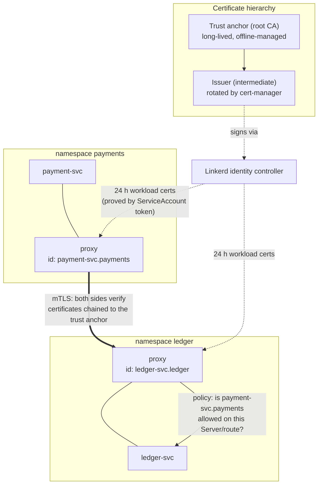

# Mã hóa đường truyền & danh tính workload với service mesh (mTLS)

## 1. Kiểm soát tài liệu

| Trường | Giá trị |
|-------|-------|
| **Phiên bản tài liệu** | 1.0 |
| **Ngày** | 31/10/2026 |
| **Tác giả** | TikTuzki |
| **Người review** | — |
| **Người phê duyệt** | — |
| **Trạng thái** | Bản nháp |

---

## 2. Giới thiệu

### 2.1 Mục đích

Định nghĩa cách traffic giữa các workload trong cluster Kubernetes được **mã hóa**, và cách mỗi
workload có một **danh tính mật mã** mà phía nhận có thể verify và phân quyền — mà không phải sửa
code ứng dụng. Thiết kế dùng một service mesh (Linkerd) cho mutual TLS tự động, danh tính suy ra từ
ServiceAccount của Kubernetes, và các policy phân quyền mặc định từ chối, dựa trên chính các danh
tính đó.

### 2.2 Phạm vi

**Trong phạm vi**

- Mã hóa và xác thực hai chiều cho traffic TCP và HTTP giữa các pod.
- Danh tính workload: được cấp, xoay vòng và verify như thế nào.
- Phân quyền theo danh tính ở tầng mạng (workload nào được kết nối tới port hoặc route nào).
- Cây chứng chỉ và vòng đời của nó (trust anchor, issuer, chứng chỉ workload).
- Các vấn đề vận hành mesh: thứ tự khởi động, Job, nhận diện protocol, ingress, kho dữ liệu.
- Kế hoạch triển khai và kiểm chứng.

**Ngoài phạm vi**

- Phân quyền theo từng thao tác và ngữ cảnh người dùng cuối —
  xem [Xác thực giữa các service với Keycloak](/docs/system-design/service-auth/keycloak-client-credentials-sdd).
  Mesh trả lời *workload nào đang kết nối*; token trả lời *caller đó được làm gì*.
- Traffic từ internet đi vào cluster (TLS ở biên, tại ingress/gateway).
- Xác thực kho dữ liệu (user database, ACL của broker) — mesh mã hóa các kết nối đó nhưng không
  thay thế cơ chế xác thực riêng của chúng.

### 2.3 Định nghĩa & thuật ngữ

| Thuật ngữ | Ý nghĩa |
|------|---------|
| **mTLS** | Mutual TLS — cả client và server cùng trình chứng chỉ và verify lẫn nhau. |
| **Danh tính workload** | Tên mật mã của một workload đang chạy, gắn với ServiceAccount của nó (ví dụ `payment-svc.payments.serviceaccount.identity.linkerd.cluster.local`). |
| **Trust anchor** | Chứng chỉ root CA mà mọi proxy tin tưởng. Sống lâu; khi nó hết hạn, toàn bộ mesh hỏng cùng lúc. |
| **Issuer** | CA trung gian được trust anchor ký; dùng để ký chứng chỉ workload. Được xoay vòng định kỳ. |
| **Proxy / sidecar** | Tiến trình data plane của mesh chạy cạnh mỗi container ứng dụng, đầu cuối và khởi tạo mTLS. |
| **Opaque port** | Port mà proxy coi là TCP thô (không nhận diện protocol) — bắt buộc với các protocol mà server nói trước. |
| **Server / AuthorizationPolicy** | Tài nguyên policy của Linkerd: `Server` chọn pod và port; `AuthorizationPolicy` nói danh tính nào được truy cập. |

---

## 3. Tổng quan hệ thống

### 3.1 Bối cảnh và vấn đề cần sửa

Khi không có mesh, traffic giữa các pod trong Kubernetes là plaintext và ẩn danh:

- **Bất kỳ ai trên đường đi đều đọc được.** Trong một node, đường đi là cục bộ, nhưng giữa các
  node nó đi qua mạng vật lý, và bất kỳ node bị chiếm quyền hay pod chạy host-network nào cũng có
  thể quan sát.
- **Phía nhận không biết ai đã kết nối.** Một kết nối chỉ mang IP nguồn, mà IP của pod liên tục bị
  tái sử dụng. Một NetworkPolicy cho phép "pod có label `app=payment`" là đang tin một label mà bất
  kỳ deployment nào cũng tự đặt được, chứ không phải một bằng chứng mật mã.
- **Ứng dụng tự làm TLS hiếm khi verify danh tính.** TLS một chiều tới một service nội bộ chứng
  minh *server* với client, và thường chỉ chứng minh nó giữ *một* chứng chỉ nào đó từ *một* CA nào
  đó — caller vẫn ẩn danh.

Các cách sửa nửa vời phổ biến đều để lại lỗ hổng:

| Cách làm | Mã hóa | Chứng minh danh tính caller | Lỗ hổng |
|----------|----------|------------------------|-----|
| Chỉ NetworkPolicy | Không | Không (label/IP) | Plaintext; label không phải danh tính |
| WireGuard giữa các node (CNI) | Giữa các node | Không | Traffic trong cùng node vẫn plaintext; không có danh tính hay policy theo workload |
| TLS một chiều ở ứng dụng | Có | Không | Caller ẩn danh; mỗi ứng dụng tự quản lý chứng chỉ |
| mTLS tự làm ở ứng dụng | Có | Có | Mỗi ứng dụng tự load, xoay vòng và verify chứng chỉ — và chính bước reload là chỗ hỏng |
| **mTLS bằng service mesh** | Có | Có | Phụ thuộc vận hành vào mesh (mục 9) |

### 3.2 Mục tiêu & tiêu chí thành công

| # | Mục tiêu | Tiêu chí thành công |
|---|-----------|-------------------|
| O1 | Mọi traffic giữa các workload trong mesh đều được mã hóa | `linkerd viz edges` cho thấy mọi edge đều secured; kết nối plaintext tới port trong mesh bị từ chối |
| O2 | Mỗi workload có danh tính riêng | Mỗi workload một ServiceAccount; không workload nào chạy bằng `default` |
| O3 | Port chỉ truy cập được bởi những danh tính cần nó | Default inbound policy `deny` (sau giai đoạn audit); mọi Server có AuthorizationPolicy tường minh |
| O4 | Chứng chỉ không bao giờ hết hạn mà không ai hay | Issuer xoay vòng tự động; cảnh báo hạn trust anchor trước ít nhất 60 ngày; chứng chỉ workload xoay mỗi 24 giờ |
| O5 | Không sửa code ứng dụng cho việc mã hóa hay danh tính | Service vẫn nói HTTP/TCP thường với proxy ngay cạnh nó |
| O6 | Chi phí của mesh nằm trong ngân sách | p99 tăng thêm mỗi chặng dưới khoảng 1–2 ms; bộ nhớ của proxy nằm trong giới hạn |

---

## 4. Thiết kế kiến trúc

### 4.1 Tổng quan kiến trúc



Đường đi của request: ứng dụng gửi HTTP thường tới proxy của chính nó; proxy mở một kết nối mTLS
tới proxy đích, trình chứng chỉ workload của mình; proxy đích verify chuỗi chứng chỉ và danh tính
phía bên kia, áp dụng policy phân quyền, rồi chuyển tiếp plaintext qua loopback của pod tới ứng
dụng.

### 4.2 Nguyên tắc thiết kế

1. **Danh tính đến từ ServiceAccount.** Workload chứng minh nó là ai bằng ServiceAccount token
   được project vào pod; mesh đổi nó thành một chứng chỉ sống ngắn. Vì vậy mỗi workload có
   ServiceAccount riêng.
2. **Mặc định mã hóa, phân quyền tường minh.** Đưa vào mesh là mọi thứ được mã hóa; phân quyền bắt
   đầu ở chế độ audit, sau đó chuyển sang mặc định từ chối với các cho phép tường minh.
3. **Lá sống ngắn, gốc được xoay vòng.** Chứng chỉ workload sống 24 giờ; issuer xoay vòng tự động;
   trust anchor có quy trình xoay vòng thành văn bản và có cảnh báo.
4. **Mesh không phải là phân quyền cho thao tác nghiệp vụ.** Nó quyết định workload nào được kết
   nối; ứng dụng vẫn quyết định caller được làm gì.
5. **Ưu tiên sự nhàm chán.** Chọn Linkerd thay vì một mesh nhiều tính năng, vì nó ít failure mode
   hơn và các mặc định của nó (mTLS tự động, không cần cấu hình cho từng service) khớp với mục tiêu.

### 4.3 Thành phần

| Thành phần | Trách nhiệm |
|-----------|----------------|
| Control plane của Linkerd | Identity controller (cấp chứng chỉ workload), destination controller (service discovery, phân phối policy), proxy injector |
| Proxy Linkerd (mỗi pod một proxy) | Đầu cuối/khởi tạo mTLS, ép buộc inbound policy, phát golden metrics |
| cert-manager | Cấp và xoay vòng chứng chỉ issuer của Linkerd từ trust anchor |
| trust-manager | Phân phối bundle trust anchor (hỗ trợ hai anchor cùng lúc khi xoay vòng) |
| Tài nguyên policy | `Server`, `AuthorizationPolicy`, `MeshTLSAuthentication`, `HTTPRoute` cho mỗi workload được bảo vệ |
| NetworkPolicy (CNI) | Phòng thủ nhiều lớp ở L3/L4, kể cả cho các pod không nằm trong mesh |

### 4.4 Lựa chọn công nghệ

| Lựa chọn | Chọn khi | Không chọn khi |
|--------|-------------|----------|
| **Linkerd** (được chọn) | Mục tiêu là mTLS + danh tính + policy theo workload với vận hành tối thiểu; phần lớn là service HTTP/gRPC | Bạn cần quản lý traffic L7 phong phú, federation đa cluster nâng cao, hoặc workload chạy trên VM |
| Istio (sidecar hoặc ambient) | Bạn cần policy L7 nâng cao, điều phối traffic, khả năng mở rộng sâu; ambient tránh được sidecar | Team không gánh nổi bề mặt vận hành của nó; chế độ PERMISSIVE thường bị bỏ quên mãi mãi |
| Cilium mesh / WireGuard | Mục tiêu chính là mã hóa giữa các node và CNI đã là Cilium | Bạn cần danh tính theo workload được verify trên mọi kết nối |
| mTLS tự làm với cert-manager | Chỉ một hai service, không muốn dùng mesh | Nhiều hơn vài service — việc reload và verify chứng chỉ bị cài lại ở từng ứng dụng |

---

## 5. Thiết kế chi tiết

### 5.1 Cây chứng chỉ

| Chứng chỉ | Thời hạn | Quản lý bởi | Xoay vòng |
|-------------|----------|------------|----------|
| Trust anchor (root, ECDSA P-256) | 5–10 năm | Team platform; private key giữ bên ngoài cluster | Có kế hoạch: thêm anchor mới vào bundle, cuộn issuer, gỡ anchor cũ |
| Issuer (trung gian) | 48 giờ – 1 năm | `Certificate` của cert-manager, được anchor ký | Tự động; Linkerd nhận secret mới |
| Chứng chỉ workload | 24 giờ | Identity controller của Linkerd | Tự động, trước khi hết hạn |

```yaml
# The trust anchor's key signs only the issuer; keep the key outside the cluster where possible.
apiVersion: cert-manager.io/v1
kind: Issuer
metadata: { name: linkerd-trust-anchor, namespace: linkerd }
spec:
  ca: { secretName: linkerd-trust-anchor }      # root cert + key (or use an external CA issuer)
---
apiVersion: cert-manager.io/v1
kind: Certificate
metadata: { name: linkerd-identity-issuer, namespace: linkerd }
spec:
  secretName: linkerd-identity-issuer
  duration: 48h
  renewBefore: 25h
  issuerRef: { name: linkerd-trust-anchor, kind: Issuer }
  commonName: identity.linkerd.cluster.local
  dnsNames: [identity.linkerd.cluster.local]
  isCA: true
  privateKey: { algorithm: ECDSA }
  usages: [cert sign, crl sign, server auth, client auth]
```

Cài Linkerd với `identity.issuer.scheme=kubernetes.io/tls` để nó đọc issuer từ secret đó thay vì
từ một file tĩnh, và truyền **chứng chỉ** trust anchor (không phải key) làm identity trust roots.

**Sự cố kinh điển của mesh là trust anchor hoặc issuer hết hạn.** Chứng chỉ sinh ra bởi CLI trong
hướng dẫn nhanh có hạn một năm; một năm sau, mọi proxy cùng lúc từ chối mọi peer. Hãy cảnh báo cả
hai thời điểm hết hạn (cert-manager xuất metric `certmanager_certificate_expiration_timestamp_seconds`;
anchor cần một phép kiểm tra riêng), và diễn tập xoay vòng anchor trước khi cần đến.

### 5.2 Danh tính workload

- **Mỗi workload một ServiceAccount**, đặt theo tên workload, `automountServiceAccountToken` theo
  nhu cầu của workload. Dùng chung ServiceAccount `default` khiến mọi workload trong namespace có
  cùng một danh tính, và policy dựa trên danh tính sụp đổ.
- Định dạng danh tính: `<serviceaccount>.<namespace>.serviceaccount.identity.linkerd.cluster.local`.
- Identity controller verify ServiceAccount token được project vào pod trước khi ký, nên một pod
  không thể nhận danh tính của workload khác nếu không có token của workload đó.

### 5.3 Đưa workload vào mesh

Bật injection theo từng namespace, và chủ động opt-out khi cần:

```yaml
apiVersion: v1
kind: Namespace
metadata:
  name: payments
  annotations:
    linkerd.io/inject: enabled
    config.linkerd.io/default-inbound-policy: audit   # → deny after the audit phase
```

| Vấn đề | Triệu chứng | Cách xử lý |
|---------|---------|----------|
| **Thứ tự khởi động** | Ứng dụng khởi động trước proxy và các lời gọi ra ngoài đầu tiên thất bại | Native sidecar (Kubernetes 1.29+, `config.alpha.linkerd.io/proxy-enable-native-sidecar: "true"`), hoặc `config.linkerd.io/proxy-await: enabled` |
| **Job và CronJob** | Job không bao giờ hoàn tất vì proxy vẫn chạy | Native sidecar; nếu không, job phải tự tắt proxy khi kết thúc |
| **Init container** | Chạy trước proxy nên không dùng được mesh | Chỉ để init container làm việc cục bộ; với native sidecar, proxy khởi động trước |
| **Protocol mà server nói trước** | Việc nhận diện protocol chờ byte từ client mà không bao giờ đến, kết nối bị treo | Đánh dấu port là opaque. Mặc định đã gồm 25, 587, 3306, 4444, 5432, 6379, 9300, 11211 — **Kafka (9092/9093) không có**; cần annotate `config.linkerd.io/opaque-ports` |
| **Pod hostNetwork** | Không thể đưa vào mesh | Để chúng ngoài các namespace có mesh; truy cập chúng bằng NetworkPolicy tường minh |
| **Probe của kubelet** | Probe không phải mTLS | Linkerd tự cho phép probe tới các path khai báo trong pod spec — giữ probe trên path riêng |
| **Ingress** | Chặng ingress → service là plaintext nếu ingress không nằm trong mesh | Đưa ingress controller vào mesh (chế độ injection `ingress` cho các controller kiểu nginx) |

### 5.4 Policy phân quyền

Ba giai đoạn: **audit** (log những gì lẽ ra bị từ chối), rồi **mặc định từ chối**, rồi **cho phép
tường minh** theo từng port hoặc route.

```yaml
# The port being protected
apiVersion: policy.linkerd.io/v1beta3
kind: Server
metadata: { name: ledger-http, namespace: ledger }
spec:
  podSelector: { matchLabels: { app: ledger-svc } }
  port: http
  proxyProtocol: HTTP/1
---
# Who may connect
apiVersion: policy.linkerd.io/v1alpha1
kind: MeshTLSAuthentication
metadata: { name: ledger-callers, namespace: ledger }
spec:
  identities:
    - payment-svc.payments.serviceaccount.identity.linkerd.cluster.local
    - reconciliation-job.ops.serviceaccount.identity.linkerd.cluster.local
---
apiVersion: policy.linkerd.io/v1alpha1
kind: AuthorizationPolicy
metadata: { name: ledger-http-callers, namespace: ledger }
spec:
  targetRef: { group: policy.linkerd.io, kind: Server, name: ledger-http }
  requiredAuthenticationRefs:
    - { group: policy.linkerd.io, kind: MeshTLSAuthentication, name: ledger-callers }
```

API version ở trên khớp với các bản phát hành Linkerd gần đây và đã thay đổi qua các phiên bản;
kiểm tra phiên bản của bạn bằng `kubectl api-resources --api-group=policy.linkerd.io`. Default
policy `audit` cũng yêu cầu một bản phát hành gần đây.

Để kiểm soát chi tiết hơn, hãy nhắm vào một `HTTPRoute` (ví dụ chỉ `POST /internal/entries`) thay
vì cả Server. Giữ policy cạnh manifest của workload, để việc thêm một caller mới là một thay đổi
được review ở phía callee, không bao giờ là một quy tắc cho phép rộng cho cả namespace.

Việc từ chối theo policy hiện ra là `403` với HTTP và kết nối bị từ chối với TCP. Ở chế độ audit,
chúng được log và đếm nhưng vẫn cho qua — đó là cách tìm ra các quy tắc cho phép còn thiếu trước
khi ép buộc.

### 5.5 Kho dữ liệu và StatefulSet

| Lựa chọn | Khi nào |
|--------|------|
| Đưa kho dữ liệu vào mesh (opaque port) | Có mã hóa và danh sách cho phép theo danh tính (chỉ `payment-svc` được tới Postgres 5432). Chạy được, nhưng traffic replication và failover giữa các thành viên cũng đi qua proxy — hãy đưa các service stateless vào mesh trước |
| Dùng TLS gốc của kho dữ liệu, mesh bỏ qua port đó | Khi TLS của chính kho dữ liệu với verify đầy đủ đã được thiết lập, hoặc protocol cluster của nó hoạt động sai khi có proxy ở giữa |

Dù theo cách nào, kho dữ liệu vẫn giữ cơ chế xác thực riêng (user database, ACL của broker): mesh
chứng minh workload nào đã kết nối, không chứng minh nó nên dùng role database nào.

### 5.6 Egress

Traffic đi ra khỏi cluster không được mTLS của mesh bao phủ. Giữ TLS ra ngoài tới bên thứ ba ở
trong ứng dụng với verify chứng chỉ đầy đủ, và giới hạn egress bằng NetworkPolicy (hoặc một egress
gateway) để một workload bị chiếm quyền không thể tới các đích tùy ý.

---

## 6. Tích hợp & giao diện

- **Với phân quyền bằng token**: không đổi. Ứng dụng vẫn verify bearer token (xem SDD về Keycloak).
  Mesh thêm một lớp kiểm tra thứ hai, độc lập: một token bị đánh cắp là vô dụng nếu gửi từ một
  workload có danh tính không được phép tới port đó.
- **Với NetworkPolicy**: giữ nguyên. NetworkPolicy bao phủ các pod không nằm trong mesh và được CNI
  ép buộc ngay cả khi một proxy bị cấu hình sai.
- **Với observability**: mesh phát tỉ lệ thành công, độ trễ và khối lượng request theo từng route
  cho mọi workload trong mesh mà không cần instrument. `tcpdump` trên traffic của pod giờ chỉ thấy
  ciphertext — hãy dùng công cụ tap của mesh để xem request.

---

## 7. Thiết kế bảo mật

| Mối đe dọa | Biện pháp |
|--------|------------|
| Nghe lén traffic giữa các pod (giữa hoặc trong node) | mTLS giữa các proxy cho mọi traffic trong mesh |
| Mạo danh workload bằng IP hoặc label | Danh tính là chứng chỉ lấy được bằng chính ServiceAccount token của workload |
| Di chuyển ngang từ một pod bị chiếm quyền | Inbound policy mặc định từ chối; chỉ các danh tính được liệt kê mới tới được từng port hoặc route |
| Chứng chỉ workload bị đánh cắp | Thời hạn 24 giờ; gắn với danh sách cho phép của một danh tính |
| Key của issuer bị lộ | Xoay vòng issuer; thời hạn issuer ngắn giới hạn mức phơi nhiễm |
| Key của trust anchor bị lộ | Quy trình xoay vòng anchor; key giữ bên ngoài cluster |
| Quay về plaintext | Port trong mesh từ chối kết nối không phải mTLS khi policy đã được ép buộc; giám sát các edge không nằm trong mesh |
| Cấu hình mesh sai làm mở quyền truy cập | Policy được review cùng workload; giai đoạn audit trước khi từ chối; NetworkPolicy là lớp độc lập |

---

## 8. Hiệu năng & khả năng mở rộng

| Hạng mục | Chi phí điển hình |
|------|-------------|
| Độ trễ mỗi chặng | Thêm dưới một mili giây tới khoảng 1–2 ms ở p99 (hai proxy cho mỗi request) |
| Bộ nhớ proxy | Vài chục MB mỗi pod; đặt requests/limits cho container proxy |
| CPU proxy | Tỉ lệ với tốc độ request; chi phí bắt tay TLS được chia nhỏ nhờ tái sử dụng kết nối |
| Cân bằng tải | Proxy cân bằng theo từng request (không theo từng kết nối), sửa được tình trạng tải lệch do các kết nối HTTP/2 và gRPC sống lâu |

Đo trên traffic thật trong quá trình triển khai; đặt SLO cho phần p99 tăng thêm và rút một
namespace ra nếu nó vượt ngưỡng.

---

## 9. Độ tin cậy & tính sẵn sàng

- **Control plane HA**: chạy control plane của Linkerd với nhiều replica (giá trị HA). Kết nối hiện
  có và chứng chỉ đã cache vẫn hoạt động nếu control plane tạm thời không sẵn sàng, nhưng pod mới
  không nhận được danh tính.
- **Chứng chỉ hết hạn** là failure mode chủ đạo — xem 5.1. Cảnh báo hạn của anchor và issuer, và
  cảnh báo khi proxy báo lỗi danh tính.
- **Nâng cấp**: control plane trước, sau đó cuộn lại các workload để nhận phiên bản proxy mới, lần
  lượt từng namespace.
- **Lệch đồng hồ**: việc kiểm tra chứng chỉ phụ thuộc thời gian; giữ các node đồng bộ NTP.
- **Lối thoát khẩn cấp**: gỡ annotation injection và khởi động lại workload sẽ đưa nó ra khỏi mesh;
  hãy ghi lại cách làm, và biết rằng nó bỏ qua policy của mesh (NetworkPolicy vẫn áp dụng).

---

## 10. Kế hoạch triển khai

| Giai đoạn | Thay đổi | Tiêu chí hoàn thành |
|-------|--------|----------------|
| 0. Chuẩn bị | Mỗi workload một ServiceAccount; cây chứng chỉ với cert-manager; cảnh báo hạn chứng chỉ | Không workload nào dùng `default`; issuer xoay vòng được ở staging |
| 1. Cài đặt | Control plane Linkerd (HA) với issuer bên ngoài | `linkerd check` đạt |
| 2. Đưa service stateless vào mesh | Inject lần lượt từng namespace với policy `audit`; native sidecar; opaque port cho Kafka | Mọi edge secured trong `linkerd viz edges`; độ trễ trong ngân sách |
| 3. Đưa ingress vào mesh | Inject ingress controller | Các edge ingress → service đều secured |
| 4. Viết policy | `Server` + `AuthorizationPolicy` cho từng workload, dựa trên các edge quan sát được | Log audit không có lần từ chối nào trong trọn một chu kỳ nghiệp vụ |
| 5. Ép buộc | Default inbound policy `deny` cho từng namespace | Các bài test phủ định (mục 11) đạt |
| 6. Kho dữ liệu | Đưa kho dữ liệu vào mesh với opaque port, hoặc verify TLS gốc và bỏ qua | Kết nối tới kho dữ liệu được mã hóa và nằm trong danh sách cho phép |

---

## 11. Kiểm chứng

```bash
# Every edge is mTLS ("√" in SECURED)
linkerd viz edges deployment -n payments

# Identity of the peers on a live connection
linkerd viz tap deploy/ledger-svc -n ledger | grep tls=true

# A pod with a non-allowed identity is refused (expect 403 / connection refused)
kubectl run probe --rm -it -n default --image=curlimages/curl -- \
  curl -s -o /dev/null -w '%{http_code}\n' http://ledger-svc.ledger:8080/internal/entries

# A non-meshed client cannot talk plaintext to a meshed, enforced port (expect refused)
kubectl run plain --rm -it -n unmeshed --image=curlimages/curl -- \
  curl -s -m 5 http://ledger-svc.ledger:8080/actuator/health/readiness

# Certificate expiries are visible
kubectl -n linkerd get certificate linkerd-identity-issuer -o jsonpath='{.status.notAfter}'
```

Giữ các kiểm tra phủ định trong một job chạy định kỳ: hồi quy về policy luôn im lặng cho tới khi có
người bị tấn công.

---

## 12. Rủi ro & biện pháp

| Rủi ro | Ảnh hưởng | Biện pháp |
|------|--------|------------|
| Trust anchor hoặc issuer hết hạn | Mọi lời gọi trong mesh thất bại cùng lúc | cert-manager xoay vòng; cảnh báo hạn; đã diễn tập xoay vòng anchor |
| Bỏ sót một caller khi chuyển sang deny | Caller đó ngừng hoạt động | Giai đoạn audit; policy suy ra từ các edge quan sát được, không dựa vào trí nhớ |
| Port của protocol server-nói-trước không được đánh dấu opaque | Kết nối bị treo (trông như service chết) | Kiểm kê port; annotate Kafka và mọi protocol tùy biến |
| Job không bao giờ xong / ứng dụng khởi động trước proxy | Job bị kẹt, khởi động thất bại | Native sidecar; proxy-await |
| ServiceAccount dùng chung | Policy theo danh tính mất ý nghĩa | Cổng kiểm soát ở giai đoạn 0: mỗi workload một ServiceAccount |
| Coi mesh là phân quyền | Tin quá mức vào bất kỳ workload nào được cho phép | Giữ phân quyền theo từng thao tác bằng token trong ứng dụng |
| Chi phí proxy trên các đường nóng | Không đạt SLO độ trễ | Đo theo từng namespace; tinh chỉnh tài nguyên proxy; chỉ loại trừ khi có lý do được ghi lại |

---

## 13. Checklist review

- [ ] Mỗi workload có ServiceAccount riêng; không workload nào dùng `default`
- [ ] Key của trust anchor giữ bên ngoài cluster; issuer được cert-manager cấp và xoay vòng
- [ ] Cảnh báo kích hoạt từ sớm trước khi trust anchor và issuer hết hạn; đã diễn tập xoay vòng anchor
- [ ] Namespace được đưa vào mesh với native sidecar (hoặc proxy-await); Job hoàn tất được
- [ ] Kafka và các port có protocol server-nói-trước khác được đánh dấu opaque
- [ ] Ingress controller nằm trong mesh
- [ ] Default inbound policy là `deny` sau giai đoạn audit; mọi Server có AuthorizationPolicy tường minh
- [ ] Policy nằm cùng manifest của callee và nêu đích danh các danh tính cụ thể
- [ ] Mọi edge hiển thị secured; danh tính không được phép và client plaintext đều bị từ chối
- [ ] Kho dữ liệu hoặc nằm trong mesh với opaque port, hoặc dùng TLS gốc đã verify — và vẫn giữ xác thực riêng
- [ ] Ứng dụng vẫn verify token để phân quyền theo từng thao tác
- [ ] NetworkPolicy vẫn được giữ như một lớp độc lập
